# API_DEMO_GUIDE — Food Bosco (Backend / API)

> **Estado:** VIGENTE · **Última revisión:** 2026-10-20. Guía de defensa/demo del backend.
> Reconstruida **leyendo el código real** (resolvers, controllers, orchestrators, services, repositorios, guards, env, tests), no sólo la documentación.
> Fuente de verdad: el código. Donde la documentación (`README.md`, `CLAUDE.md`, `docs/especificaciones/*`) contradice al código, se marca explícitamente en **§21**.
> Documento hermano (frontend): `Food-Bosco-Frontend/docs/FRONTEND_DEMO_GUIDE.md`.

---

## Tabla de contenidos

1. [Resumen ejecutivo](#resumen-ejecutivo)
2. [Arquitectura completa](#1-arquitectura-completa)
3. [Arranque de los servicios](#2-arranque-de-los-servicios)
4. [GraphQL Gateway](#3-graphql-gateway)
5. [Autenticación](#4-autenticación)
6. [Autorización y aislamiento por rol](#5-autorización-y-aislamiento-por-rol)
7. [Commerce Service](#6-commerce-service)
8. [Delivery Service](#7-delivery-service)
9. [Eventos y mensajería](#8-eventos-y-mensajería)
10. [Modelo de datos](#9-modelo-de-datos)
11. [Superficie GraphQL](#10-superficie-graphql)
12. [Superficie REST](#11-superficie-rest)
13. [Flujos end-to-end](#12-flujos-end-to-end)
14. [Algoritmos y reglas](#13-algoritmos-y-reglas)
15. [Validaciones](#14-validaciones)
16. [Errores](#15-errores)
17. [Observabilidad y operación](#16-observabilidad-y-operación)
18. [Testing](#17-testing)
19. [Configuración y deployment](#18-configuración-y-deployment)
20. [Seguridad](#19-seguridad)
21. [Límites, riesgos y deuda técnica](#20-límites-riesgos-y-deuda-técnica)
22. [Código real por encima de documentación](#21-código-real-por-encima-de-documentación)
23. [Qué tengo que saber para la demo](#qué-tengo-que-saber-para-la-demo)
24. [Preguntas que podrían hacerme](#22-preguntas-que-podrían-hacerme)
25. [Diagramas](#23-diagramas)
26. [Glosario](#24-glosario)
27. [Resumen oral 5 minutos](#si-tuviera-que-explicar-el-backend-en-5-minutos)
28. [Resumen 1 minuto](#si-sólo-tuviera-1-minuto)
29. [Checklist de estudio](#25-checklist-de-estudio)
30. [Evidencia del código](#26-evidencia-del-código)

---

# Resumen ejecutivo

Food Bosco es una plataforma de pedidos de comida. El backend es un **monorepo Turborepo** con **cuatro aplicaciones NestJS**:

| App             | Puerto   | Protocolo                                     | Persistencia | Responsabilidad                                                                                     |
| --------------- | -------- | --------------------------------------------- | ------------ | --------------------------------------------------------------------------------------------------- |
| `apps/gateway`  | **4000** | **GraphQL** (`POST /graphql`) + REST auxiliar | **Ninguna**  | Punto de entrada, autenticación, RBAC, rate limiting, composición, traducción a REST, uploads, seed |
| `apps/auth`     | **4201** | REST `/v1`                                    | MongoDB      | Identidad, login, tokens, perfiles, usuarios, direcciones, recuperación de contraseña               |
| `apps/commerce` | **4202** | REST `/v1`                                    | MongoDB      | Catálogo, productos/configuraciones/recetas, sucursales, carrito, pedidos, stock, reportes          |
| `apps/delivery` | **4203** | REST `/v1`                                    | MongoDB      | Repartidores, disponibilidad/ubicación, ofertas, viajes, entrega                                    |

Stack: **NestJS 11 + TypeScript**, **Mongoose 8 / MongoDB**, **Apollo Server 5** (sólo en el gateway), **JWT** (`jsonwebtoken`), **bcryptjs**, **class-validator**, **Cloudinary**, **RabbitMQ opcional** (`amqplib`).

Lo más importante para la demo:

> **El gateway no tiene lógica de negocio ni base de datos.** Sólo valida identidad/rol, aplica throttling, traduce GraphQL a llamadas REST y compone relaciones. Toda la lógica de dominio vive en `auth`, `commerce` y `delivery`; cada servicio es dueño de sus colecciones dentro de una **misma base MongoDB** (`fastfood` por defecto).

Regla estructural del proyecto (definida en `CLAUDE.md` y respetada en el código):

> **Un servicio primario nunca llama a otro servicio primario. La coordinación pertenece al orchestrator.**

Flujo interno: `controller → orchestrator (si hay coordinación) → servicio primario → repositorio → MongoDB`.

---

# 1. Arquitectura completa

## 1.1 Monorepo

Turborepo + npm workspaces (`package.json` raíz: `"workspaces": ["apps/*", "packages/*"]`). `turbo.json` orquesta `build`, `dev`, `lint`, `typecheck`, `test`, `format`.

```text
food-bosco-api/
├── apps/
│   ├── gateway/     # GraphQL (4000), sin DB
│   ├── auth/        # REST /v1 (4201)
│   ├── commerce/    # REST /v1 (4202)
│   └── delivery/    # REST /v1 (4203)
├── packages/
│   ├── eslint-config/       # @repo/eslint-config
│   ├── typescript-config/   # @repo/typescript-config
│   └── seed-utils/          # @repo/seed-utils (carga de JSON, idempotencia, runner)
├── scripts/seed.mjs         # seed directo a DB, orden commerce → auth → delivery
├── docs/                    # especificaciones, auditoría, testing, histórico
├── turbo.json
└── package.json
```

## 1.2 Mapa conceptual real (request GraphQL)

```text
Frontend (Apollo Client)
   ↓  POST /graphql   Authorization: Bearer <accessToken>
Gateway (NestJS + Apollo, puerto 4000)
   ↓  buildContext(jwtService): verifica JWT y arma { userId, roles, branchId, requestId }
   ↓  AuthGuard (metadata @Roles / @Authenticated) por resolver
   ↓  ThrottlerGuard global (100 req/min por token o IP)
   ↓  Resolver: traduce args a una llamada REST (RestClient)
   ↓  headers: Authorization, x-user-id, x-user-roles, x-branch-id, x-request-id
Servicio REST (auth 4201 / commerce 4202 / delivery 4203)
   ↓  RolesGuard global (JWT propio + metadata) o @Internal (x-internal-token)
   ↓  ValidationPipe global (whitelist + transform)
   ↓  controller → orchestrator → service → repository → MongoDB
   ↓  respuesta JSON  ó  { code, message, path } con HTTP status
Gateway
   ↓  mapX(raw) → objeto GraphQL tipado
   ↓  resolveField con DataLoader (Order.client, Order.branch, Product.category…)
   ↓  GraphQL response (errores normalizados por formatGraphQLError)
Frontend
```

## 1.3 Responsabilidades de cada app

### Gateway (`apps/gateway/src/`)

- **No tiene base de datos** ni modelos Mongoose.
- `gateway/gateway.module.ts`: configura `GraphQLModule` con `autoSchemaFile: true`, `sortSchema: true`, `context: buildContext(jwtService)`, `formatError: formatGraphQLError`; playground/introspección sólo fuera de producción.
- `security/`: `JwtService` (verifica HS256), `AuthGuard` (roles/sesión en GraphQL), `RolesGuard` (usado por el upload REST), `InternalGuard` (seed).
- `rest/`: `RestClient` (fetch + headers de identidad), `RestModule` (clientes auth/commerce/delivery), `DataLoader` propio.
- `graphql/`: `AuthResolver`, `CommerceResolver`, `DeliveryResolver`, field resolvers y DataLoaders.
- `throttle/`: `GatewayThrottlerGuard` global.
- `upload/`: `POST /v1/uploads` (proxy a commerce).
- `seed/`: `POST /seed` (orquesta el seed de los tres servicios con token interno).
- `observability/`: `RequestIdMiddleware`, `formatGraphQLError`.

### Auth (`apps/auth/src/`)

- `auth/`: login, register, register-rider, refresh, logout, password recovery/reset (`AuthOrchestrator`).
- `user/`: `UserService`, `StaffOrchestrator` (valida sucursal contra commerce), `MeController`, `UserController`.
- `refresh-token/`: refresh tokens opacos, hasheados, rotativos, con TTL.
- `password-recovery/`: tokens de un solo uso, TTL y ventana mínima entre solicitudes.
- `address/`: CRUD de direcciones del cliente (soft delete, ownership).
- `email/`: provider `log` (default) o `resend`.
- `seed/`: usuarios y direcciones.

### Commerce (`apps/commerce/src/`)

- `category/`, `product/`, `ingredient/`, `promotion/`: catálogo.
- `branch/`: sucursales, horarios, cobertura por distancia, disponibilidad producto-sucursal.
- `cart/`: carrito server-side.
- `order/`: creación de pedidos, máquina de estados, historial, repetición.
- `stock/`: stock por sucursal + movimientos.
- `reporting/`: agregaciones MongoDB para reportes.
- `parameter/`: parámetros de negocio (`MAX_DISTANCE_KM`, `BASE_PREP_MIN`, `AVG_SPEED_KMH`).
- `order-state/`: catálogo configurable de estados (sólo UI/admin).
- `upload/`: subida a Cloudinary.
- `seed/`: catálogo, sucursales, stock, pedidos de ejemplo.

### Delivery (`apps/delivery/src/`)

- `rider/`: perfil del repartidor (creado on-demand desde auth), vehículo, disponibilidad, ubicación, status (`offline/free/on_trip`).
- `delivery-order/`: proyección local de pedidos listos (`ready/reserved/assigned`), rotación de repartidores, dedupe de eventos.
- `offer/`: generación perezosa de ofertas, aceptar/rechazar, pickup/deliver.
- `trip/`: viajes (`offered/active/completed/cancelled`).
- `zone/`, `shift/`: CRUD de zonas y turnos (hoy no intervienen en el matching).
- `seed/`: rider, zonas, turnos y, opcionalmente, un pedido listo.

## 1.4 Stack tecnológico

| Capa       | Tecnología                                 | Evidencia                                    |
| ---------- | ------------------------------------------ | -------------------------------------------- |
| Framework  | NestJS 11                                  | `apps/*/package.json`                        |
| Lenguaje   | TypeScript 5.7                             | `apps/*/package.json`                        |
| GraphQL    | Apollo Server 5 + `@nestjs/graphql` 13     | `apps/gateway`                               |
| REST       | `@nestjs/platform-express`                 | servicios                                    |
| DB         | MongoDB + Mongoose 8                       | `config/database/database.module.ts`         |
| Auth       | `jsonwebtoken` (HS256) + `bcryptjs`        | `security/jwt.service.ts`, `user.service.ts` |
| Validación | `class-validator` + `class-transformer`    | `main.ts` de cada REST + DTOs                |
| Rate limit | `@nestjs/throttler`                        | `apps/gateway/src/throttle`                  |
| Uploads    | `cloudinary`                               | `apps/commerce/src/upload`                   |
| Eventos    | `amqplib` (RabbitMQ) opcional / in-process | `config/messaging`                           |
| Seed       | `@repo/seed-utils` + JSON                  | `apps/*/src/seed/data/*.json`                |
| Tests      | Jest + Supertest + `mongodb-memory-server` | `apps/*/test`                                |

## 1.5 Capas y regla de oro

Ejemplo real de coordinación (`apps/commerce/src/order/order.orchestrator.ts`):

```text
OrderController.create(dto)
  → OrderOrchestrator.create(clientId, dto)
      → CartService.findActiveByClient
      → BranchService.findAvailable(lat, lng)
      → BranchService.getAvailabilityMap(branchId)
      → ProductService.findByIds
      → StockService.validateAvailability
      → ParameterService.getValue (ETA)
      → OrderService.create
      → CartService.confirm
```

Ejemplo de servicio primario aislado: `ProductService` sólo habla con `ProductRepository` y, como mucho, con sus reglas propias (`config-group.rules.ts`). No consulta `StockService` ni `BranchService`.

Ejemplo en delivery (`offer.orchestrator.ts`): coordina `RiderService`, `TripService`, `DeliveryOrderService`, `CommerceClient` y `EventBus`. Los servicios primarios (`TripService`, `DeliveryOrderService`) no se llaman entre sí.

## 1.6 Dependencias entre apps

```text
Frontend
   ↓ GraphQL
Gateway ──REST──→ Auth ──REST(interno)──→ Commerce   (sólo valida sucursal al crear staff)
   ├──────REST──→ Commerce
   └──────REST──→ Delivery ──REST(interno)──→ Commerce (PATCH estado de pedido en pickup/deliver)
                        └────REST(interno)──→ Auth     (perfil del rider on-demand)

Commerce ⇄ Delivery  por eventos (RabbitMQ si BROKER_URL; si no, in-process)
```

Las llamadas cruzadas viven **siempre en orchestrators** (`StaffOrchestrator`, `RiderOrchestrator`, `OfferOrchestrator`), nunca en un `Service` primario.

## 1.7 Dónde se decide cada cosa

| Decisión                                 | Dónde se toma                               | Evidencia                                     |
| ---------------------------------------- | ------------------------------------------- | --------------------------------------------- |
| Validar credenciales / emitir tokens     | `auth`                                      | `AuthOrchestrator`, `UserService`             |
| Firmar/verificar JWT                     | `auth` firma; gateway y servicios verifican | `JwtService` de cada app                      |
| Autorizar por rol                        | gateway + cada servicio                     | `AuthGuard`, `RolesGuard`                     |
| Resolver la dirección del pedido         | gateway (con el token del cliente)          | `CommerceResolver.createOrder`                |
| Asignar sucursal                         | `commerce`                                  | `BranchService.findAvailable` + `branches[0]` |
| Validar disponibilidad producto-sucursal | `commerce`                                  | `getAvailabilityMap`                          |
| Calcular precio/total                    | `commerce`                                  | `CartOrchestrator`, `OrderOrchestrator`       |
| Validar/descontar stock                  | `commerce`                                  | `StockService`                                |
| Validar transición de estado             | `commerce`                                  | `ORDER_TRANSITIONS`, `applyTransition`        |
| Calcular ETA                             | `commerce`                                  | `computeEta` + `ParameterService`             |
| Elegir rider/oferta                      | `delivery`                                  | `OfferOrchestrator.listOffers`                |
| Calcular ruta/ganancia                   | `delivery`                                  | `buildRoute`, `estimateEarnings`              |
| Reservar pedidos de un viaje             | `delivery`                                  | `DeliveryOrderRepository.reserve`             |
| Persistir ubicación del rider            | `delivery`                                  | `PATCH /v1/riders/me/location`                |
| Decidir zonas/turnos                     | **no se decide** (CRUD sin efecto)          | `zones`, `shifts`                             |
| Aplicar promociones                      | **no se aplica**                            | `promotions` sólo CRUD                        |
| Procesar pagos                           | **no existe**                               | sin módulo ni pasarela                        |
| Geocoding                                | frontend (Geoapify)                         | el backend recibe lat/lng                     |

---

# 2. Arranque de los servicios

## 2.1 Gateway

`apps/gateway/src/main.ts`:

```ts
const app = await NestFactory.create(AppModule)
app.enableCors()
await app.listen(env.port) // 4000
```

No hay `ValidationPipe` global ni filtro HTTP global: la validación de entrada es la del **esquema GraphQL**; la validación fina ocurre en los DTOs de los servicios REST. Los errores se normalizan con `formatGraphQLError`.

`AppModule` importa: `SecurityModule`, `GatewayModule`, `HealthModule`, `SeedModule`, `ThrottleModule`, `UploadModule`; aplica `RequestIdMiddleware` a `*`.

`GatewayModule` importa `RestModule`, los tres módulos GraphQL y configura Apollo (`autoSchemaFile`, contexto, formatter, playground según `NODE_ENV`).

## 2.2 Servicios REST

Los tres (`auth`, `commerce`, `delivery`) siguen el mismo `main.ts`:

```ts
const app = await NestFactory.create(AppModule)
app.enableCors()
app.useGlobalPipes(
  new ValidationPipe({
    whitelist: true,
    transform: true,
    transformOptions: { enableImplicitConversion: true },
  }),
)
app.useGlobalFilters(new HttpExceptionFilter())
await app.listen(env.port) // 4201 / 4202 / 4203
```

- `whitelist: true` elimina propiedades no declaradas en el DTO.
- `enableImplicitConversion` convierte query params (`limit`, `offset`, `active`) a sus tipos.
- Todos los servicios registran `RolesGuard` como `APP_GUARD` en `SecurityModule` y `RequestIdMiddleware` global.

## 2.3 Base de datos

Cada servicio abre su propia conexión con Mongoose al mismo URI:

```ts
MongooseModule.forRoot(env.mongoUri) // default: mongodb://localhost:27017/fastfood
```

No hay migraciones ni repositorio compartido: el contrato es “cada servicio es dueño de sus colecciones” aun cuando compartan la base.

## 2.4 Orden de arranque en desarrollo

1. MongoDB disponible.
2. `npm run dev` (Turborepo levanta las 4 apps en paralelo).
3. Opcional: RabbitMQ + `BROKER_URL` si se quiere el flujo de eventos cross-service real.
4. Opcional: `npm run seed` o `POST /seed` en el gateway.

El gateway no falla si los servicios están caídos: falla la operación que intente llamarlos (`RestClient` propaga el error como `GraphQLError` con código `INTERNAL_SERVER_ERROR` o el código que devuelva el servicio).

---

# 3. GraphQL Gateway

## 3.1 Configuración

`apps/gateway/src/gateway/gateway.module.ts`:

```ts
GraphQLModule.forRootAsync<ApolloDriverConfig>({
  driver: ApolloDriver,
  useFactory: (jwtService) => ({
    autoSchemaFile: true,
    sortSchema: true,
    context: buildContext(jwtService),
    formatError: formatGraphQLError,
    preserveHttpStatusForExecutionErrors: false,
    introspection: env.nodeEnv !== 'production',
    playground: env.nodeEnv !== 'production',
  }),
})
```

- **Un único endpoint:** `POST /graphql`.
- El SDL se genera en memoria (`autoSchemaFile: true`); no hay archivo `.graphql` ni codegen.
- En producción se desactivan introspección y playground.

## 3.2 Contexto

`buildContext` toma el header `authorization`, lo verifica con `JwtService` y arma:

```ts
{
  ;(authenticated, userId, roles, branchId, requestId, authorization, req, res)
}
```

El `JwtService` del gateway **no consulta la base**: sólo valida firma y expiración. Los roles y el `branchId` salen del payload del JWT.

## 3.3 Resolvers

| Resolver                   | Dominio                                                 | Guard                        |
| -------------------------- | ------------------------------------------------------- | ---------------------------- |
| `AuthResolver`             | auth, usuarios, direcciones                             | `AuthGuard` a nivel de clase |
| `CommerceResolver`         | catálogo, carrito, pedidos, stock, reportes, parámetros | `AuthGuard` a nivel de clase |
| `DeliveryResolver`         | rider, ofertas, viajes                                  | `AuthGuard` a nivel de clase |
| `ProductFieldResolver`     | `Product.category`                                      | sin guard (field resolver)   |
| `OrderFieldResolver`       | `Order.client`, `Order.branch`, `Order.riderLocation`   | sin guard                    |
| `CartItemFieldResolver`    | `CartItem.product`, `CartItem.options`                  | sin guard                    |
| `BranchStockFieldResolver` | `BranchStock.ingredient`                                | sin guard                    |
| `TripOrderFieldResolver`   | `TripOrder.order`                                       | sin guard                    |

Los resolvers son **finos**: traducen args, llaman a `RestClient` con `toRestContext(ctx)` y mapean con `mapX`.

## 3.4 DataLoaders (importante y matizable)

`commerce.dataloaders.ts` crea loaders por request (`req.__commerceLoaders`):

- `category`, `ingredient`, `product`, `branch`, `order`, `user`.

El `DataLoader` propio (`rest/data-loader.ts`) **deduplica claves** dentro del mismo tick y agrupa el dispatch, pero `buildByIdLoader` resuelve cada clave con **un `GET` individual** (`Promise.all`). Es decir:

- **Sí** evita pedir dos veces el mismo `branchId` en una misma query.
- **No** convierte N ids distintos en un único request batch (los servicios no exponen `?ids=`).

Conclusión honesta para la defensa: el gateway **mitiga** el N+1 por deduplicación, no lo elimina por completo. Para una lista de 20 pedidos con 20 clientes distintos, siguen siendo 20 llamadas a auth (en paralelo).

`Order.riderLocation` no usa loader: hace un `GET /v1/riders/by-user/:id` por pedido y devuelve `null` si falla.

## 3.5 Traducción GraphQL ↔ REST

- Enums GraphQL en mayúsculas (`PENDING`, `READY_FOR_DELIVERY`) ↔ strings REST en minúsculas (`pending`, `ready_for_delivery`) mediante `orderStatusFromRest` / `orderStatusToRest`.
- `Role` GraphQL (`CUSTOMER`, `BRANCH_ADMIN`, …) ↔ REST (`customer`, `branch_admin`, …) en `role.enum.ts`.
- `ConfigGroupType` (`SINGLE`/`MULTIPLE`) ↔ `single`/`multiple`.
- `ReportGroupBy` (`DAY`/`WEEK`/`MONTH`) ↔ `day`/`week`/`month`.
- Los mappers (`mapProduct`, `mapOrder`, `mapTrip`, `mapRider`, `mapUser`…) normalizan `_id → id`, strings, números, nulos y enums.

## 3.6 Rate limiting

- `ThrottleModule` registra `GatewayThrottlerGuard` como `APP_GUARD`.
- Límite global: `THROTTLE_LIMIT` por `THROTTLE_TTL_MS` (default **100 req / 60 s**).
- Tracker: **el header `Authorization` completo** si existe; si no, la IP.
- Overrides por handler: recuperación de contraseña **5/min**; reset **10/min**.
- Si se excede, devuelve un `GraphQLError` con `extensions.code = TOO_MANY_REQUESTS`.

## 3.7 Uploads (REST auxiliar)

`POST /v1/uploads` (multipart, campo `file`):

1. `RolesGuard` exige `super_admin` (JWT).
2. `FileInterceptor` limita a `UPLOAD_MAX_SIZE_BYTES` (default **5 MB**) y valida que el mimetype empiece con `image/`.
3. Reenvía a commerce `POST /v1/catalog/uploads` con `x-internal-token`? **No**: reenvía el contexto del usuario (Authorization, userId, roles, branchId, requestId).
4. Commerce valida mimetype permitido (**jpg, png, webp, gif**), tamaño y sube a **Cloudinary**.
5. Devuelve `{ url }`.

> El frontend usa este endpoint REST para subir imágenes de producto. Es la única llamada REST directa del frontend; el resto es GraphQL.

## 3.8 Seed por HTTP

`POST /seed` (sin `/v1`) con header `x-internal-token`:

1. `InternalGuard` valida el token.
2. Llama `POST /v1/seed` a commerce → obtiene sucursales.
3. Llama `POST /v1/seed` a auth con las sucursales → crea usuarios y direcciones.
4. Llama `POST /v1/seed` a commerce otra vez con el cliente/dirección → crea pedidos de ejemplo.
5. Llama `POST /v1/seed` a delivery con el rider y (si hay) un pedido `ready_for_delivery`.

Es idempotente por claves naturales (email, nombre de sucursal, etc.).

## 3.9 Errores GraphQL

`formatGraphQLError` devuelve:

```json
{
  "message": "...",
  "path": ["createOrder"],
  "extensions": { "code": "INSUFFICIENT_STOCK", "path": "/v1/orders" }
}
```

- `code` sale de `extensions.code` del error (si el servicio devolvió un `code` propio) o cae a `INTERNAL_SERVER_ERROR`.
- `httpStatus` del error REST **no se conserva** en la respuesta GraphQL.
- `TOO_MANY_REQUESTS` se mapea explícitamente.

---

# 4. Autenticación

## 4.1 Endpoints

| Método | Ruta                         | Acceso                                  | Qué hace                                              |
| ------ | ---------------------------- | --------------------------------------- | ----------------------------------------------------- |
| POST   | `/v1/auth/register`          | público                                 | crea **customer** (`app: store`) y devuelve tokens    |
| POST   | `/v1/auth/register-rider`    | `super_admin`                           | crea **rider** con vehículo                           |
| POST   | `/v1/auth/login`             | público                                 | email + password + `app` → tokens (valida rol vs app) |
| POST   | `/v1/auth/refresh`           | público (requiere refresh token válido) | rota tokens                                           |
| POST   | `/v1/auth/logout`            | autenticado                             | revoca **todos** los refresh tokens del usuario       |
| POST   | `/v1/auth/password-recovery` | público                                 | solicita email de recuperación                        |
| POST   | `/v1/auth/reset-password`    | público (requiere token)                | cambia contraseña y revoca sesiones                   |

`login` y `register` reciben un campo obligatorio `app` (`STORE`, `ADMIN`, `BRANCH`, `RIDER`). El Auth Service valida que el rol del usuario pertenezca a esa app y responde `403 APP_ROLE_MISMATCH` sin emitir tokens si no coincide.

## 4.2 Login

```text
LoginDto (email, password, app)
→ AuthOrchestrator.login
→ UserService.verifyCredentials
    → repository.findByEmailWithPassword (select +passwordHash)
    → bcrypt.compare
    → si !active → 403 USER_INACTIVE
→ assertAppRole(app, user.role)
    → si el rol no pertenece a la app → 403 APP_ROLE_MISMATCH
→ issueTokens(user)
    → JwtService.signAccessToken({ id, role, branchId })
    → RefreshTokenService.issue(user.id)
→ { accessToken, refreshToken }
```

- Contraseñas: **bcrypt, 10 rounds** (`BCRYPT_ROUNDS = 10`).
- Email: schema `lowercase: true, trim: true`; el repositorio busca por email tal cual (el schema normaliza al guardar).
- Credenciales inválidas y usuario inexistente devuelven el **mismo** `401 INVALID_CREDENTIALS` (no filtra existencia).

## 4.3 Access token (JWT)

Payload firmado con `jsonwebtoken` (HS256 por defecto):

```json
{
  "sub": "<userId>",
  "userId": "<userId>",
  "roles": ["customer"],
  "branchId": null,
  "iat": 123,
  "exp": 123
}
```

- Expiración: `JWT_ACCESS_EXPIRES_IN` (default **15m**).
- No incluye `iss`/`aud`; no hay validación de esos campos.
- Los servicios **no decodifican** el token para autorizar por sí mismos: usan el `AuthContext` que arma su `JwtService` (firma + expiración) y los headers `x-user-*` que manda el gateway.

## 4.4 Refresh token

- Token **opaco**: 32 bytes aleatorios en hex (`randomToken(32)`), no JWT.
- Se guarda **hasheado** con SHA-256 (`tokenHash`), nunca en claro.
- Colección `refreshTokens` con índice único por hash e índice TTL por `expiresAt`.
- TTL: `JWT_REFRESH_EXPIRES_IN` (default **7d**).
- **Rotación de un solo uso:** `consume` hace `findOneAndUpdate({ tokenHash, revoked: false }, { revoked: true })`. Si el token ya fue usado/revocado o expiró → `401 INVALID_REFRESH_TOKEN`.
- Si el usuario está inactivo, el refresh falla (`401`) y el token ya quedó revocado.
- `logout` y `reset-password` ejecutan `revokeAllForUser`.

Consecuencia: **no hay detección de reuso con revocación de familia**; simplemente el segundo uso falla. El access token anterior sigue siendo válido hasta su expiración (≤15m).

## 4.5 Flujo de refresh desde el frontend

El frontend (Apollo `errorLink`) detecta `UNAUTHENTICATED`, llama `refreshToken` una sola vez (singleton `refreshPromise`), aplica los tokens nuevos y reintenta la operación. El backend sólo ve un refresh válido y devuelve tokens nuevos.

## 4.6 Registro

- `register` siempre crea `customer`; no acepta rol desde el cliente.
- `register-rider` exige `super_admin`. También existe `POST /v1/users/riders` (super_admin) para crear riders.
- **No hay auto-registro público de riders**: el rider se crea desde el admin o por seed.
- `RegisterDto`: nombres ≤100, email válido, teléfono ≤50, password **8–128**.

## 4.7 Recuperación de contraseña

```text
POST /v1/auth/password-recovery { email }
→ AuthOrchestrator.requestPasswordRecovery
   → si el email no existe: responde 200 igual (neutral)
   → PasswordRecoveryService.create(userId)
       → si hay un token activo creado hace < PASSWORD_RECOVERY_MIN_INTERVAL (60s): no crea otro
       → invalida tokens activos previos
       → genera token opaco, guarda SHA-256 + expiresAt (default 1h)
   → EmailService.sendPasswordRecovery
       → URL: `${FRONTEND_URL_del_rol}${PASSWORD_RESET_PATH}?token=...`
       → provider log (default) o Resend
→ 200 { ok: true } siempre
```

- `POST /v1/auth/reset-password { token, newPassword }`: consume el token (un solo uso, verifica expiración), actualiza el hash y **revoca todos los refresh tokens**.
- El link se arma con la URL del frontend correspondiente al **rol** del usuario: `STORE_URL`, `ADMIN_URL`, `BRANCH_URL` o `RIDER_URL`.
- En desarrollo, `EMAIL_PROVIDER=log` imprime el mail (y por ende el link) en el log del servicio auth.
- Si `EMAIL_PROVIDER=resend` y falta `RESEND_API_KEY`, el servicio **no arranca** (`EmailModule` lanza al construir el provider).
- Errores de envío: se loguean; el endpoint igual responde 200 (no filtra si el email existe).

## 4.8 Usuarios y staff

| Endpoint                     | Acceso                          | Regla                                                          |
| ---------------------------- | ------------------------------- | -------------------------------------------------------------- |
| `GET /v1/users`              | super_admin                     | filtros `role`, `active`, `search`; paginado                   |
| `GET /v1/users/:id`          | super_admin **o** token interno | usado por gateway (DataLoader `user`) y delivery               |
| `POST /v1/users/staff`       | super_admin                     | crea `branch_admin`; valida que la sucursal exista en commerce |
| `POST /v1/users/admins`      | super_admin                     | crea `super_admin`                                             |
| `POST /v1/users/riders`      | super_admin                     | crea `rider`                                                   |
| `PATCH /v1/users/:id`        | super_admin                     | edita datos; si cambia `branchId`, valida sucursal             |
| `PATCH /v1/users/:id/active` | super_admin                     | activa/desactiva                                               |
| `GET/PATCH /v1/me`           | autenticado                     | perfil propio; `PATCH` sólo nombre/teléfono                    |

- **No se puede editar ni desactivar a un `super_admin`** (`requireEditable` devuelve `403 FORBIDDEN`).
- `branch_admin` debe tener `branchId`; se valida contra commerce vía `CommerceClient.branchExists` (timeout 5s → `503`/`502`).

## 4.9 Direcciones

- Sólo `customer`.
- Ownership siempre por `userId` del token.
- `DELETE` es **soft delete** (`active: false`); los listados sólo traen activas.
- IDs inválidos (`no ObjectId`) devuelven `null`/`[]` o 404, no 500.

---

# 5. Autorización y aislamiento por rol

## 5.1 Roles

```text
customer | branch_admin | super_admin | rider
```

Están definidos por separado en cada app (`config/constants.ts`) y mapeados en el gateway (`Role` enum). Un JWT contiene **un** rol en `roles: [role]`.

## 5.2 Identidad entre servicios

El gateway manda:

```text
Authorization: Bearer <accessToken>
x-user-id: <userId>
x-user-roles: customer,branch_admin,...
x-branch-id: <branchId | vacío>
x-request-id: <uuid>
x-internal-token: <sólo llamadas internas>
```

Los servicios:

- Verifican el JWT por su cuenta (`JwtService.verify`) para autenticar.
- Usan `x-user-*` / el `AuthContext` derivado del JWT para **scoping**.
- Para rutas `@Internal()`, aceptan `x-internal-token === INTERNAL_API_TOKEN` y marcan `internal: true` (sin rol).

## 5.3 Guards

### Gateway

`AuthGuard` (GraphQL):

1. Lee metadata `@Roles(...)` y `@Authenticated()`.
2. Si no hay ninguna → **público**.
3. Si hay → exige `authenticated` (JWT válido).
4. Si hay roles → exige intersección con `ctx.roles`.
5. Error: `UnauthorizedException` → `UNAUTHENTICATED`; `ForbiddenException` → `FORBIDDEN` (verificado por e2e).

### Servicios REST

`RolesGuard` global:

1. Si `@Internal()` y el header `x-internal-token` coincide → inyecta `internal: true` y **saltea roles**.
2. Si no, verifica el JWT.
3. `needsAuth = @Authenticated || @Roles.length > 0 || @Internal`.
4. Sin auth → `401`; rol insuficiente → `403`.

> **Importante:** `@Internal()` **no** hace la ruta pública: si no viene el token interno, sigue exigiendo JWT y roles. Ejemplo: `PATCH /v1/orders/:id/status` acepta `branch_admin`/`super_admin` **o** el token interno (delivery).

## 5.4 Matriz de autorización (GraphQL)

| Operación                                                                                                                                                                                                                 | Público |   customer   |   branch_admin   | super_admin |     rider      |
| ------------------------------------------------------------------------------------------------------------------------------------------------------------------------------------------------------------------------- | :-----: | :----------: | :--------------: | :---------: | :------------: |
| `categories`, `category`, `products`, `product`                                                                                                                                                                           |   ✅    |      ✅      |        ✅        |     ✅      |       ✅       |
| `branches`, `branch`, `branchHours`, `availableBranches`, `nearbyBranches`                                                                                                                                                |   ✅    |      ✅      |        ✅        |     ✅      |       ✅       |
| `ingredients` (list), `promotions`/`promotion`, `parameters`                                                                                                                                                              |    —    |      —       |        —         |     ✅      |       —        |
| `ingredient(id)`                                                                                                                                                                                                          |   ✅    |      ✅      |        ✅        |     ✅      |       ✅       |
| `branchProducts`                                                                                                                                                                                                          |    —    |      —       | ✅ (su sucursal) |     ✅      |       —        |
| `myCart`, `addCartItem`, `updateCartItem`, `removeCartItem`, `createOrder`, `repeatOrder`, `myOrders`                                                                                                                     |    —    |      ✅      |        —         |      —      |       —        |
| `orders`                                                                                                                                                                                                                  |    —    |      —       | ✅ (su sucursal) |     ✅      |       —        |
| `order`, `orderHistory`                                                                                                                                                                                                   |    —    | ✅ (propias) | ✅ (su sucursal) |     ✅      | ✅ (asignadas) |
| `orderStates`                                                                                                                                                                                                             |    —    |      ✅      |        ✅        |     ✅      |       ✅       |
| `branchStock`, `adjustStock`, `reportsOverview`, `bestSellingProducts`, `leastSoldProducts`, `outOfStockProducts`, `highestRevenueProducts`                                                                               |    —    |      —       | ✅ (su sucursal) |     ✅      |       —        |
| `changeOrderStatus`, `setBranchActive`, `setBranchProductAvailability`                                                                                                                                                    |    —    |      —       | ✅ (su sucursal) |     ✅      |       —        |
| `users`, `user`, `createStaff`, `createAdmin`, `createRider`, `updateUser`, `setUserActive`                                                                                                                               |    —    |      —       |        —         |     ✅      |       —        |
| `me`, `updateProfile`                                                                                                                                                                                                     |    —    |      ✅      |        ✅        |     ✅      |       ✅       |
| `myAddresses`, `address`, `createAddress`, `updateAddress`, `deleteAddress`                                                                                                                                               |    —    |      ✅      |        —         |      —      |       —        |
| `riderProfile`, `tripOffers`, `trip`, `myTrips`, `updateRiderProfile`, `updateRiderVehicle`, `setRiderAvailability`, `updateRiderLocation`, `acceptTripOffer`, `rejectTripOffer`, `markOrderPickup`, `markOrderDelivered` |    —    |      —       |        —         |      —      |       ✅       |
| `register`, `login`, `refreshToken`, `requestPasswordRecovery`, `resetPassword`                                                                                                                                           |   ✅    |      ✅      |        ✅        |     ✅      |       ✅       |
| `registerRider`                                                                                                                                                                                                           |    —    |      —       |        —         |     ✅      |       —        |

> `order`/`orderHistory` delegan el ownership al servicio: super_admin; branch_admin de la sucursal; rider asignado; o el cliente dueño. Si no, el servicio responde `404 ORDER_NOT_FOUND` (no 403, para no filtrar existencia).

## 5.5 Scoping por rol (dónde se aplica de verdad)

- **customer:** el `clientId` se toma del JWT. Aunque mande otro `clientId`, se ignora.
- **branch_admin:** el `branchId` se toma del JWT; si intenta acceder a otra sucursal, `403 FORBIDDEN`.
  - `GET /v1/orders` fuerza `branchId = auth.branchId`.
  - `GET /v1/stock`, `GET /v1/reporting/*` fuerzan `branchId`.
  - `PATCH /v1/branches/:id/active`, `GET/PATCH /v1/branches/:id/products` validan `auth.branchId`.
  - `PATCH /v1/orders/:id/status` valida que el pedido sea de su sucursal.
- **super_admin:** sin scoping; puede filtrar por `branchId` si quiere.
- **rider:** sólo sus ofertas/viajes (`riderId` del JWT); `rider/me` siempre por `userId`.
- **internal:** bypass de scoping y roles (usado por delivery para cambiar estados).

## 5.6 Restricción visual ≠ autorización

El frontend oculta botones según el rol, pero la autorización real está en el backend:

- Gateway filtra por rol.
- Servicios vuelven a validar (rol, ownership, sucursal, estado).
- Las rutas internas exigen token interno.

Esto es **defensa en profundidad**: si alguien llama a un servicio REST directamente con un JWT de customer, el `RolesGuard` del servicio lo rechaza igual.

> **Matiz importante:** la confianza no es total. Ejemplo: `POST /v1/orders` (commerce) acepta `addressId` + `deliveryAddress` y **no** verifica contra auth que la dirección pertenezca al cliente. Esa verificación la hace el **gateway** (`createOrder` resuelve la dirección con el token del usuario antes de llamar a commerce). Por eso los servicios REST **no deben exponerse públicamente**.

---

# 6. Commerce Service

## 6.1 Catálogo

### Categorías

- `GET /v1/catalog/categories`: público. `super_admin` ve inactivas por defecto; el resto sólo activas.
- `POST`, `PATCH`, `PATCH /active`: super_admin.
- Nombre único (índice único), `active`.

### Productos

- `GET /v1/catalog/products`: público; `available=true` por defecto para no-admin; filtros `categoryId`, `search`, `available`, paginado.
- `GET /v1/catalog/products/:id`: público (puede devolver un producto no disponible).
- `POST/PATCH/PATCH /available`: super_admin.
- `ProductOrchestrator` valida que la categoría exista; `ProductService` valida reglas de configuración/receta.
- Nombre único; `price` requerido; `image` opcional.

### Configuraciones (grupos/opciones)

- `GET/POST/PATCH/DELETE /v1/catalog/products/:id/configurations[/:groupId]`.
- `POST/PATCH/DELETE .../options[/:optionId]`.
- Sólo super_admin.
- Reglas (`config-group.rules.ts`):
  - Si `required=true`, debe tener `min`.
  - `min`/`max` no negativos.
  - `min ≤ max`.
  - `extraPrice` de opción no negativo.
- Tipo `single`/`multiple`.

### Recetas

- `GET/PUT /v1/catalog/products/:id/recipe`, `POST/PATCH/DELETE .../recipe/items[/:itemId]`.
- Sólo super_admin.
- Cada ítem: `ingredientId`, `quantity > 0`, `optionAdjustments[]` (opción + cantidad > 0).
- El ingrediente debe existir (validado en `ProductOrchestrator`).
- No se permite el mismo ingrediente dos veces: se fusionan cantidades y ajustes (`mergeRecipeItems`).
- Los `optionAdjustments.optionId` deben pertenecer a opciones del producto (`assertRecipeOptionAdjustments`).
- Desactivar un ingrediente usado por un producto **disponible** devuelve `409 INGREDIENT_IN_USE`.

## 6.2 Sucursales, horarios y cobertura

`Branch` (colección `branches`):

```text
name (único), addressText, latitude, longitude, phone, active
hours[]: { dayOfWeek, opening, closing, closed }
```

- `GET /v1/branches`: super_admin, paginado.
- `GET /v1/branches/:id`, `/hours`, `available`, `nearby`, `available/products`: públicos.
- `POST/PATCH`, `PUT /hours`: super_admin.
- `PATCH /:id/active`: branch_admin (sólo su sucursal) o super_admin.
- `GET /:id/products`, `PATCH /:id/products/:productId/availability`: branch_admin (su sucursal) o super_admin.

### Horarios (`isBranchOpenNow`)

- `dayOfWeek`: **0 = domingo … 6 = sábado** (coincide con `Date.getUTCDay()`); el seed genera 0–6.
- Zona horaria de negocio: **America/Argentina/Buenos_Aires** (`BUSINESS_TIME_ZONE`).
- Soporta horarios que cruzan medianoche (`closing < opening`): considera la entrada del día actual y la del día anterior.
- Si no hay entrada para el día o `closed=true`, está cerrada.

### Cobertura (`BranchService.findAvailable`)

1. Toma sucursales `active=true`.
2. Filtra las abiertas **ahora**.
3. Filtra distancia Haversine ≤ `MAX_DISTANCE_KM` (parámetro, default 10).
4. Ordena por distancia ascendente.
5. Devuelve la lista; **el pedido usa `[0]`**.

`findInZone` (endpoint `nearby`) no exige que estén abiertas: ordena primero abiertas y luego por distancia.

### Disponibilidad producto-sucursal

Colección `branchProductAvailability` con índice único `(branchId, productId)`.

- Si **no hay fila**, el producto se considera disponible (`?? true`).
- Sólo una fila con `available=false` lo bloquea.
- `GET /v1/branches/:id/products` devuelve todos los productos con `availableInBranch`.
- `GET /v1/branches/available/products?lat&lng` usa la **sucursal más cercana disponible** y devuelve sus productos.

## 6.3 Carrito

Modelo (colección `carts`):

```text
clientId, status (active|confirmed), items[], total
item: { productId, quantity, observations, optionIds[] }
```

- Un carrito **activo** por cliente (`findOne({clientId, status:'active'})`). No hay índice único `(clientId,status)`: dos requests concurrentes podrían crear dos carritos.
- `GET /v1/carts` crea el carrito si no existe.
- `POST /v1/carts/items`: agrega una línea; valida producto disponible y opciones disponibles; **recalcula el total desde precios actuales**.
- `PATCH /v1/carts/items/:itemId`: cantidad/observaciones/opciones; recalcula.
- `DELETE /v1/carts/items/:itemId`: elimina y recalcula.
- `POST /v1/carts/confirm`: marca `confirmed` (no crea pedido). **El flujo real no lo usa**: `createOrder` confirma el carrito por dentro.
- El carrito es **branch-agnóstico**: no se sabe la sucursal hasta el checkout.
- Precio unitario = `product.price + Σ option.extraPrice` (siempre con datos del servidor).
- `quantity ≥ 1` (DTO); observaciones ≤ 500.
- No se fusionan líneas idénticas: cada `addItem` crea una línea nueva.
- `repeatOrder` **reemplaza** el carrito con los ítems del pedido anterior (no agrega), omitiendo productos no disponibles y devolviendo `skippedProducts`.

## 6.4 Creación de pedido (núcleo)

`POST /v1/orders` (customer) → `OrderOrchestrator.create(clientId, input)`:

```text
1. cart = CartService.findActiveByClient(clientId)
   si no existe o está vacío → 400 CART_NOT_FOUND

2. branches = BranchService.findAvailable(deliveryAddress.lat, lng)
   si vacío → 409 NO_BRANCH_AVAILABLE
   branch = branches[0]           ← la más cercana abierta dentro del radio

3. availability = BranchService.getAvailabilityMap(branch.id)

4. buildOrderItems(cart.items, availability)
   - producto actual (no el del carrito) y `available`
   - si availability.get(productId) === false → 400 PRODUCT_UNAVAILABLE
   - opciones resueltas contra el producto actual; si no existe/no disponible → 400
   - unitPrice = product.price + Σ extras
   - subtotal = unitPrice * quantity
   - requirements = receta acumulada (con ajustes por opción) * quantity

5. StockService.validateAvailability(branch.id, requirements)
   - si falta stock → 409 INSUFFICIENT_STOCK

6. total = Σ subtotales
7. estimatedDeliveryAt = now + BASE_PREP_MIN + minutos(distancia / AVG_SPEED_KMH)
8. OrderService.create({ ..., number = count()+1 padded 6, status pending, history inicial })
9. CartService.confirm(cart.id)
```

Características y límites (importantes para preguntas):

- **No hay transacción**: validar stock y crear pedido son pasos separados. Otro pedido concurrente puede consumir el stock en el medio.
- **No se reserva stock** al crear: se valida y se descuenta recién al pasar a `preparing`.
- **No hay fallback de sucursal**: si la más cercana no tiene stock de algún ingrediente, el pedido falla aunque otra sucursal pudiera cumplirlo.
- **No se aplican promociones**, ni costo de envío, ni impuestos: `total` = suma de ítems.
- El **número** de pedido es `countDocuments() + 1` (6 dígitos). Bajo concurrencia puede colisionar contra el índice único y devolver 500.
- El snapshot de dirección (`text`, `lat`, `lng`) se guarda en el pedido.
- El `clientId` sale del JWT.

## 6.5 Estados y transiciones

`ORDER_TRANSITIONS` (hardcodeado en `config/constants.ts`):

```text
pending             → confirmed | cancelled
confirmed           → preparing | cancelled
preparing           → ready_for_delivery | cancelled
ready_for_delivery  → on_the_way | cancelled
on_the_way          → delivered | cancelled
delivered           → (terminal)
cancelled           → (terminal)
```

`changeStatus` (`PATCH /v1/orders/:id/status`):

1. Busca el pedido.
2. `assertBranchAccess`: internal o super_admin pasan; branch_admin debe coincidir con `order.branchId`.
3. `OrderService.applyTransition`:
   - mismo estado → no-op (`changed=false`).
   - transición no permitida → `409 INVALID_TRANSITION`.
   - guarda `statusHistory` (`previousStatus`, `newStatus`, `changedAt`).
4. Si cambió:
   - si `newStatus === preparing` → **descuenta stock** con `reason: preparing` y `orderId`.
   - publica `order.status_changed` (con sucursal y dirección).
5. Devuelve el pedido con `availableTransitions`.

Observaciones honestas:

- **Cancelar después de `preparing` no repone stock**.
- El catálogo `orderStates` (admin) **no gobierna** las transiciones; sólo se muestra en la UI.
- `availableTransitions` se calcula en `serializeOrder` a partir de `ORDER_TRANSITIONS`.
- El `GET /v1/orders/:id/transitions` existe en REST, pero el frontend usa el campo `availableTransitions` del `Order` en GraphQL.

## 6.6 Stock

Colecciones:

- `branchStock` (`branchId`, `ingredientId`, `quantity`), único por par.
- `stockMovements` (`branchId`, `ingredientId`, `delta`, `reason`, `orderId`, `createdAt`).

Reglas:

- `adjust`: `quantity = max(0, previous + delta)`; registra el delta **efectivo** (no el pedido).
- `validateAvailability`: lee todo el stock de la sucursal y compara contra los requerimientos. Si falta → 409.
- `discount`: resta requerimientos (clamp a 0) y registra movimientos con `reason=preparing`.
- **No hay atomicidad** entre leer y escribir (`findOneAndUpdate` no es condicional sobre la cantidad). Dos pedidos concurrentes pueden sobrevender.
- `adjust` hace `upsert`: permite crear una fila de stock para un `ingredientId` inexistente si se llama directo al REST (el gateway no lo valida).
- Descuento **sólo** al pasar a `preparing`, no al crear ni al confirmar.

## 6.7 Reportes

`GET /v1/reporting/*` (branch_admin o super_admin):

- `overview`: KPIs + serie temporal + top productos + performance por sucursal + conteo por estado.
- `products/best-sellers`: productos con `quantity > 0`, orden descendente.
- `products/least-sold`: **todos** los productos, incluidos los de 0 ventas.
- `products/out-of-stock`: productos con receta cuyo mínimo stock de ingrediente es ≤ 0. Ignora productos sin receta.
- `products/highest-revenue`: productos con `revenue > 0`, orden descendente.

Semántica (verificada en `reporting.repository.ts` / `reporting.service.ts`):

- Rango default: **últimos 30 días** (`from = now - 30d`, `to = now`).
- Si `from > to` → 400.
- `variation` compara contra el período anterior de **igual duración**.
- `revenue` = `Σ order.total` de pedidos **no cancelados** (salvo que se filtre por `status`).
- `averageTicket` = revenue / órdenes.
- Serie agrupada por día/semana/mes en timezone **America/Argentina/Buenos_Aires**.
- `topProducts` limitado a 10.
- `outOfStock` con sucursal: stock de esa sucursal; sin sucursal (super_admin): considera todas las filas (puede mezclar sucursales).
- `categoryId` filtra productos (y ventas) por categoría.
- `branchId` se fuerza al del branch_admin.
- `percentChange` devuelve `null` si el período anterior fue 0.

## 6.8 Parámetros

`parameters` (`key`, `value`, `unit`), editables por super_admin:

| Key               | Uso                     | Default |
| ----------------- | ----------------------- | ------- |
| `MAX_DISTANCE_KM` | cobertura de sucursales | 10      |
| `BASE_PREP_MIN`   | ETA (preparación)       | 15      |
| `AVG_SPEED_KMH`   | ETA (viaje)             | 25      |

Se leen de la DB en cada uso; si no existen, cae a los defaults de env (`SEED_PARAM_*`).

## 6.9 Order states

- `GET /v1/config/order-states` autenticado; escrituras super_admin.
- `code`, `name`, `order`, `active`.
- Se siembran los 7 estados.
- **No se usan para validar transiciones** (ver §6.5). Es catálogo de presentación/configuración.

## 6.10 Promociones

- CRUD completo (`/v1/catalog/promotions`), sólo super_admin.
- `startDate ≤ endDate` (validador propio).
- **No se aplican** en carrito ni en pedido: no hay descuento, ni cálculo de precio promocional. Es deuda funcional visible.

## 6.11 Uploads

- `POST /v1/catalog/uploads` (super_admin) multipart.
- Formatos: jpg/png/webp/gif; tamaño máximo `UPLOAD_MAX_SIZE_BYTES` (5 MB).
- Sube a Cloudinary (`CLOUDINARY_*`, folder configurable).
- Devuelve `{ url: secure_url }`.
- Errores: `IMAGE_REQUIRED` (400), `INVALID_IMAGE_TYPE` (415), `IMAGE_TOO_LARGE` (413), `IMAGE_UPLOAD_FAILED` (502).

---

# 7. Delivery Service

## 7.1 Repartidor

Modelo `riders`:

```text
userId (único), firstName, lastName, phone, vehicle { type: moto|bici, brand?, model?, plate? }
available: boolean
status: offline | free | on_trip
currentLocation: { latitude, longitude } | null
lastSeenAt: Date | null
```

- El perfil se crea **on-demand** la primera vez que el rider llama a `/v1/riders/me`: `RiderOrchestrator.ensureProfile` pide el usuario a auth (`GET /v1/users/:id` con token interno) y normaliza el vehículo.
- `normalizeVehicle`: si el string contiene `bici` → `bici`; en cualquier otro caso → `moto`; guarda el texto original como `model`.
- `PATCH /v1/riders/me`: nombre/teléfono.
- `PATCH /v1/riders/me/vehicle`: tipo + marca/modelo/patente.
- `PATCH /v1/riders/me/availability { online }`:
  - online → `available=true`, `status=free`, `lastSeenAt=now`.
  - offline → `available=false`, `status=offline` (no actualiza `lastSeenAt`).
- `PATCH /v1/riders/me/location { lat, lng }`: actualiza `currentLocation` y `lastSeenAt`.
- `GET /v1/riders/by-user/:userId` (interno): usado por el gateway para `Order.riderLocation`.

### Staleness

`isRiderStale(rider, RIDER_STALE_AFTER_MS, now)`:

- Sin `lastSeenAt` → stale.
- `now - lastSeenAt > 5 min` (default) → stale.

Un rider online deja de ser elegible si no manda ubicación en 5 minutos.

## 7.2 Proyección de pedidos listos (`deliveryOrders`)

Colección `deliveryOrders`:

```text
orderId (único), branchId, branchLocation, deliveryAddress,
status: ready | reserved | assigned,
tripId, reservedUntil,
rotationRoster[], rotationIndex, rotationTurnUntil
```

Se llena con el evento `order.status_changed`:

- `ready_for_delivery` → `upsertReady` (sólo si no está `reserved`/`assigned`; resetea rotación).
- `cancelled` o `delivered` → `remove`.

Idempotencia: `processedEvents` (`eventId` único + TTL 7 días). El orden es “aplicar efecto y después marcar procesado”; si el handler falla, se reintenta y las escrituras son idempotentes.

## 7.3 Ofertas (algoritmo real)

`GET /v1/trips/offers` (rider):

1. Carga el perfil (`ensureProfile`).
2. Si `!available` o stale → `409 RIDER_OFFLINE`.
3. Si no hay `currentLocation` → `409 LOCATION_REQUIRED`.
4. Si `status === on_trip` → `{ data: [] }`.
5. `buildRotationContext`: arma la lista de riders activos (available + free + no stale + con ubicación) y una función `eligibleNear(branchLocation)` que filtra por distancia ≤ `MAX_MATCH_DISTANCE_KM` (default 8) y ordena por cercanía.
6. `expireStaleOffers`: libera reservas vencidas y cancela los trips `offered` asociados.
7. Si ya tiene una oferta activa (`trip` en `offered` no expirado) → la devuelve (máximo una oferta a la vez).
8. `claimableForRider`: de todos los `deliveryOrders` en `ready`, deja sólo los que están en el **turno de rotación** del rider.
9. `selectNearest`: de esos, filtra por distancia rider→sucursal ≤ 8 km, ordena por cercanía y toma hasta `MAX_ORDERS_PER_TRIP` (default 3).
10. `buildRoute`: rider → pickup 1 → delivery 1 → pickup 2 → delivery 2 … (secuencial, no TSP).
11. Calcula:
    - `distanceKm` (ruta total, redondeada a 2 decimales)
    - `estimatedMinutes = round(distanceKm / AVG_SPEED_KMH * 60)`
    - `estimatedEarnings = round(EARNINGS_BASE + EARNINGS_PER_KM * km + EARNINGS_PER_ORDER * orders)`
12. Crea un `Trip` en estado `offered` con `expiresAt = now + OFFER_TTL_SECONDS` (default **30 s**).
13. **Reserva atómica** de los pedidos: `updateMany({ orderId in [...], status: ready }, { status: reserved, tripId, reservedUntil })`.
    - Si no reservó todos → libera, cancela el trip y devuelve `[]` (otro rider ganó).
14. Devuelve la proyección de la oferta.

### Rotación (fairness)

Cada `deliveryOrder` guarda una `rotationRoster` (ids de riders elegibles cerca de la sucursal), un `rotationIndex` y `rotationTurnUntil` (ventana de **45 s**, `SAME_RIDER_COOLDOWN_SECONDS`).

- Al crear el roster, el primero de la lista (el más cercano) tiene el turno.
- Si el rider del turno está inactivo o su ventana venció, se avanza al siguiente.
- Al completar una vuelta, se refresca el roster, poniendo **primero a los riders nuevos** y luego a los que ya estaban.
- Si un rider rechaza/expira, la orden vuelve a `ready` y se avanza el turno (ese rider no la recibe de inmediato).

Esto evita que el más cercano monopolice todos los pedidos y no necesita un scheduler: la rotación avanza cuando alguien consulta.

### Por qué la oferta es “perezosa”

No hay push ni job: la oferta se materializa cuando el rider hace polling (`GET /v1/trips/offers`, el frontend cada 15 s). Si no consulta, no se le asigna nada. El TTL de 30 s y la ventana de 45 s hacen que, si no la toma, la orden se libere y pase a otro.

## 7.4 Viajes

`Trip` (`trips`):

```text
riderId, status (offered|active|completed|cancelled), orders[],
distanceKm, estimatedMinutes, estimatedEarnings, earnings,
startedAt, completedAt, expiresAt
```

`TripOrder`: `orderId`, `pickupBranchId`, `pickupLocation`, `deliveryAddress`, `status`, `pickedUpAt`, `deliveredAt`.

### Aceptar

`POST /v1/trips/offers/:offerId/accept`:

1. La oferta debe existir, ser del rider, estar `offered` y no expirada (`OFFER_NOT_FOUND`, `INVALID_TRIP_STATUS`, `OFFER_EXPIRED`).
2. `markActive` (guarda `startedAt`, limpia `expiresAt`).
3. `deliveryOrders`: `reserved → assigned` (sólo las de ese trip).
4. Rider → `on_trip`.
5. Publica `trip.accepted` (para que commerce guarde `tripId`/`riderId` en los pedidos).

### Rechazar

`POST /v1/trips/offers/:offerId/reject`:

1. Valida oferta propia/`offered`/no expirada.
2. Cancela el trip.
3. Libera los pedidos (`reserved → ready`) y avanza la rotación.

### Retirar (pickup)

`POST /v1/trips/:tripId/orders/:orderId/pickup`:

1. Trip propio y `active`.
2. La orden debe pertenecer al trip.
3. `PATCH` a commerce: `ready_for_delivery → on_the_way` (token interno).
4. Marca la orden del trip `on_the_way` + `pickedUpAt`.

### Entregar (deliver)

`POST /v1/trips/:tripId/orders/:orderId/deliver`:

1. Trip propio y `active`.
2. Orden del trip.
3. `PATCH` a commerce: `on_the_way → delivered`.
4. Marca la orden `delivered` + `deliveredAt`.
5. Si **todas** las órdenes del trip están `delivered`: trip `completed`, `completedAt`, `earnings = estimatedEarnings`; rider → `free`; publica `trip.completed`.

### Observaciones

- **No hay validación de proximidad en el backend.** El límite de 50 m es **solo del frontend** (`haversine` en `TripOrderCard`). La API acepta pickup/deliver sin comprobar la ubicación del rider.
- Si commerce falla en el `PATCH`, la operación aborta antes de actualizar el trip (la orden queda en el estado anterior).
- No hay prueba de entrega (foto/firma/código).
- `earnings` se copia de `estimatedEarnings`; no hay liquidación ni pagos.

## 7.5 Zonas y turnos

- `zones`: nombre, centro, radio, activo. `GET` público; `POST`/`PATCH` interno.
- `shifts`: nombre, hora inicio/fin, activo. `GET` público; `POST`/`PATCH` interno.
- **Hoy no se usan en el matching**: `OfferOrchestrator` sólo usa distancia + disponibilidad + staleness. Se siembran y se pueden consultar, pero no restringen ni asignan.

---

# 8. Eventos y mensajería

## 8.1 Tipos

| Evento                 | Publica                      | Consume          | Efecto                                                              |
| ---------------------- | ---------------------------- | ---------------- | ------------------------------------------------------------------- |
| `order.status_changed` | commerce (al cambiar estado) | delivery         | `ready_for_delivery` → alta en pool; `cancelled`/`delivered` → baja |
| `trip.accepted`        | delivery                     | commerce         | asigna `tripId` + `riderId` a las órdenes                           |
| `trip.completed`       | delivery                     | commerce (no-op) | sólo se publica; commerce se suscribe y no hace nada                |

Payload de `order.status_changed`:

```json
{
  "type": "order.status_changed",
  "version": 1,
  "eventId": "uuid",
  "orderId": "...",
  "status": "ready_for_delivery",
  "branchId": "...",
  "branchLocation": { "latitude": 0, "longitude": 0 },
  "deliveryAddress": { "text": "...", "latitude": 0, "longitude": 0 },
  "occurredAt": "ISO"
}
```

## 8.2 Transporte

`MessagingModule` de cada servicio decide:

```ts
env.brokerUrl ? new RabbitTransport(env.brokerUrl) : new InProcessTransport()
```

- Exchange: `fastfood.events` (topic, durable).
- Colas: `<service>.<event>` (p. ej. `delivery.order.status_changed`).
- **Si `BROKER_URL` está vacío, cada servicio usa un EventEmitter local.** Los eventos **no cruzan** procesos.

Diferencias entre implementaciones:

- **Commerce** (`rabbit.transport.ts`): `noAck: true`, publicación persistente pero sin confirmación y **sin reintentos**.
- **Delivery**: ack manual, `nack(requeue)` y descarte tras **3 intentos**; no hay DLQ configurada.

## 8.3 Idempotencia

- Delivery: `processedEvents` con `eventId` único e índice TTL de 7 días. Aplica el efecto y luego marca; si falla, el broker reintenta y las escrituras son idempotentes (`upsertReady` condicional / `remove`).
- Commerce al consumir `trip.accepted`: `updateMany` con `$set {tripId, riderId}` es idempotente (no necesita dedupe explícito).

## 8.4 Consecuencia operativa (crítica para la demo)

Sin `BROKER_URL` (default):

- Commerce publica `order.status_changed` a un emitter local: **delivery nunca se entera**.
- Por lo tanto, un pedido que pasa a `ready_for_delivery` **no aparece** en el pool de delivery y el rider **no recibe ofertas**.
- Delivery publica `trip.accepted` local: commerce **no** asigna `riderId`/`tripId` a las órdenes → `Order.riderLocation` queda `null` para el cliente.

**Cómo se hace la demo igual:**

- `POST /seed`/`npm run seed` inserta directamente un pedido `ready_for_delivery` en `deliveryOrders` (seed de delivery), salteando el evento.
- El flujo del rider (oferta → aceptar → pickup → deliver) funciona porque vive en delivery y actualiza commerce por REST interno (`PATCH /v1/orders/:id/status`).
- Lo que no se ve sin broker es la **ubicación del rider en el tracking del cliente**: `Order.riderId`/`Order.tripId` quedan `null` en commerce, así que `Order.riderLocation` devuelve `null` (y un rider no podría consultar el pedido por `order(id)`, porque el ownership se apoya en `riderId`).

Para el flujo completo real: levantar RabbitMQ y definir `BROKER_URL=amqp://...` en commerce y delivery.

---

# 9. Modelo de datos

Base única (`fastfood` por defecto), colecciones separadas por dueño.

## Auth

| Colección          | Campos clave                                                                                            | Índices                                       |
| ------------------ | ------------------------------------------------------------------------------------------------------- | --------------------------------------------- |
| `users`            | email único, passwordHash (`select:false`), role, firstName, lastName, phone, active, branchId, vehicle | email único                                   |
| `addresses`        | userId, label, text, city, postalCode, lat, lng, active                                                 | userId                                        |
| `refreshTokens`    | userId, tokenHash único, expiresAt, revoked                                                             | tokenHash único; userId; TTL `expiresAt`      |
| `passwordRecovery` | userId, tokenHash único, expiresAt, used                                                                | tokenHash único; userId+used; TTL `expiresAt` |

## Commerce

| Colección                   | Campos clave                                                                                                                                | Índices                          |
| --------------------------- | ------------------------------------------------------------------------------------------------------------------------------------------- | -------------------------------- |
| `categories`                | name único, active                                                                                                                          | name                             |
| `products`                  | categoryId, name único, description, price, image, available, configGroups[], recipe[]                                                      | name único; categoryId           |
| `ingredients`               | name único, unit, active                                                                                                                    | name                             |
| `branches`                  | name único, addressText, lat, lng, phone, active, hours[]                                                                                   | name único                       |
| `branchProductAvailability` | branchId, productId, available                                                                                                              | único `(branchId, productId)`    |
| `carts`                     | clientId, status, items[], total                                                                                                            | clientId                         |
| `orders`                    | number único, clientId, branchId, addressId, deliveryAddress, status, total, estimatedDeliveryAt, riderId, tripId, items[], statusHistory[] | number único; clientId; branchId |
| `branchStock`               | branchId, ingredientId, quantity                                                                                                            | único `(branchId, ingredientId)` |
| `stockMovements`            | branchId, ingredientId, delta, reason, orderId                                                                                              | branchId; ingredientId           |
| `promotions`                | name único, startDate, endDate, active                                                                                                      | name único                       |
| `parameters`                | key único, value, unit                                                                                                                      | key                              |
| `orderStates`               | code único, name, order, active                                                                                                             | code                             |

## Delivery

| Colección         | Campos clave                                                                                       | Índices                                   |
| ----------------- | -------------------------------------------------------------------------------------------------- | ----------------------------------------- |
| `riders`          | userId único, vehicle, phone, available, status, currentLocation, lastSeenAt                       | userId único                              |
| `deliveryOrders`  | orderId único, branchId, branchLocation, deliveryAddress, status, tripId, reservedUntil, rotation* | orderId único; `(status, createdAt)`      |
| `trips`           | riderId, status, orders[], distanceKm, estimatedMinutes, estimatedEarnings, earnings, expiresAt    | riderId                                   |
| `zones`           | name único, center, radiusKm, active                                                               | name                                      |
| `shifts`          | name único, startTime, endTime, active                                                             | name                                      |
| `processedEvents` | eventId único, processedAt                                                                         | eventId único; TTL `processedAt` (7 días) |

## Relaciones (por id, sin joins)

- `Order.clientId` → `users._id` (auth).
- `Order.branchId` / `Trip.pickupBranchId` → `branches._id`.
- `Order.riderId` → `users._id` del rider (auth).
- `Order.tripId` → `trips._id`.
- `Product.categoryId` → `categories._id`; `recipe[].ingredientId` → `ingredients._id`.
- `CartItem.productId` → `products._id`.
- `BranchStock.ingredientId` → `ingredients._id`.
- `Address.userId` → `users._id`.

El gateway resuelve las uniones cross-service por REST + DataLoader; **no hay joins en Mongo**.

---

# 10. Superficie GraphQL

## 10.1 Queries

### Catálogo y sucursales

| Query                      | Argumentos                                            | Acceso       | Notas                                           |
| -------------------------- | ----------------------------------------------------- | ------------ | ----------------------------------------------- |
| `categories`               | `activeOnly`, `page`                                  | público      | admin ve inactivas por defecto                  |
| `category`                 | `id`                                                  | público      |                                                 |
| `products`                 | `filter{categoryId,search,available,lat,lng}`, `page` | público      | con `lat`+`lng` usa disponibilidad por sucursal |
| `product`                  | `id`                                                  | público      |                                                 |
| `ingredients`              | `activeOnly`, `page`                                  | super_admin  |                                                 |
| `ingredient`               | `id`                                                  | público      | asimetría real del código                       |
| `promotions` / `promotion` | `activeOnly`/`id`                                     | super_admin  |                                                 |
| `branches`                 | `filter{active,search}`, `page`                       | super_admin  |                                                 |
| `branch`                   | `id`                                                  | público      |                                                 |
| `branchHours`              | `branchId`                                            | público      |                                                 |
| `availableBranches`        | `lat`, `lng`                                          | público      | activas + abiertas + radio                      |
| `nearbyBranches`           | `lat`, `lng`                                          | público      | incluye cerradas (ordenadas)                    |
| `branchProducts`           | `branchId`                                            | branch/super | servicio valida sucursal                        |

### Carrito, pedidos, stock y reportes

| Query                    | Argumentos                                           | Acceso                              |
| ------------------------ | ---------------------------------------------------- | ----------------------------------- |
| `myCart`                 | —                                                    | customer                            |
| `myOrders`               | `filter`, `page`                                     | customer                            |
| `orders`                 | `filter`, `page`                                     | branch/super                        |
| `order`                  | `id`                                                 | autenticado (ownership en servicio) |
| `orderHistory`           | `id`                                                 | autenticado (ownership en servicio) |
| `branchStock`            | `branchId`                                           | branch/super                        |
| `reportsOverview`        | `filter{from,to,branchId,groupBy,categoryId,status}` | branch/super                        |
| `bestSellingProducts`    | `filter`                                             | branch/super                        |
| `leastSoldProducts`      | `filter`                                             | branch/super                        |
| `outOfStockProducts`     | `filter`                                             | branch/super                        |
| `highestRevenueProducts` | `filter`                                             | branch/super                        |
| `parameters`             | —                                                    | super_admin                         |
| `orderStates`            | —                                                    | autenticado                         |

### Auth, usuarios y direcciones

| Query         | Argumentos                           | Acceso      |
| ------------- | ------------------------------------ | ----------- |
| `me`          | —                                    | autenticado |
| `users`       | `filter{role,active,search}`, `page` | super_admin |
| `user`        | `id`                                 | super_admin |
| `myAddresses` | —                                    | customer    |
| `address`     | `id`                                 | customer    |

### Delivery

| Query          | Argumentos | Acceso         |
| -------------- | ---------- | -------------- |
| `riderProfile` | —          | rider          |
| `tripOffers`   | —          | rider          |
| `trip`         | `id`       | rider (propio) |
| `myTrips`      | `page`     | rider          |

## 10.2 Mutations

| Mutation                                                                                     | Acceso       | Notas                                      |
| -------------------------------------------------------------------------------------------- | ------------ | ------------------------------------------ |
| `register(input)`                                                                            | público      | crea customer (solo `app: STORE`)          |
| `registerRider(input)`                                                                       | super_admin  | rider + vehículo                           |
| `login(input)`                                                                               | público      | tokens (valida `app` contra el rol)        |
| `refreshToken(refreshToken)`                                                                 | público      | rotación                                   |
| `logout`                                                                                     | autenticado  | revoca todos                               |
| `requestPasswordRecovery(email)`                                                             | público      | throttled 5/min                            |
| `resetPassword(token,newPassword)`                                                           | público      | throttled 10/min                           |
| `updateProfile(input)`                                                                       | autenticado  | nombre/teléfono                            |
| `createStaff` / `createAdmin` / `createRider`                                                | super_admin  |                                            |
| `updateUser` / `setUserActive`                                                               | super_admin  | no permite super_admin                     |
| `createAddress` / `updateAddress` / `deleteAddress`                                          | customer     |                                            |
| `createCategory` / `updateCategory` / `setCategoryActive`                                    | super_admin  |                                            |
| `createProduct` / `updateProduct` / `setProductAvailable`                                    | super_admin  |                                            |
| `createConfigGroup` / `updateConfigGroup` / `deleteConfigGroup`                              | super_admin  |                                            |
| `createConfigOption` / `updateConfigOption` / `deleteConfigOption`                           | super_admin  |                                            |
| `setProductRecipe` / `addRecipeItem` / `updateRecipeItem` / `removeRecipeItem`               | super_admin  |                                            |
| `createIngredient` / `updateIngredient` / `setIngredientActive`                              | super_admin  |                                            |
| `createPromotion` / `updatePromotion` / `setPromotionActive`                                 | super_admin  | no se aplican al precio                    |
| `createBranch` / `updateBranch` / `updateBranchHours`                                        | super_admin  |                                            |
| `setBranchActive`                                                                            | branch/super | branch: su sucursal                        |
| `setBranchProductAvailability`                                                               | branch/super |                                            |
| `addCartItem` / `updateCartItem` / `removeCartItem`                                          | customer     |                                            |
| `createOrder(addressId)`                                                                     | customer     | resuelve dirección en auth y crea snapshot |
| `changeOrderStatus(orderId,status)`                                                          | branch/super | transición validada                        |
| `repeatOrder(orderId)`                                                                       | customer     | reemplaza carrito                          |
| `adjustStock(input)`                                                                         | branch/super |                                            |
| `updateParameter(key,value)`                                                                 | super_admin  |                                            |
| `createOrderState` / `updateOrderState` / `setOrderStateActive`                              | super_admin  | catálogo, no transiciones                  |
| `updateRiderProfile` / `updateRiderVehicle` / `setRiderAvailability` / `updateRiderLocation` | rider        |                                            |
| `acceptTripOffer` / `rejectTripOffer`                                                        | rider        |                                            |
| `markOrderPickup` / `markOrderDelivered`                                                     | rider        |                                            |

## 10.3 Ejemplos

### Login y perfil

```graphql
mutation Login {
  login(input: { email: "cliente@foodbosco.local", password: "Cliente123!" }) {
    accessToken
    refreshToken
  }
}

# Authorization: Bearer <accessToken>
query Me {
  me {
    id
    email
    role
    branchId
  }
}
```

### Catálogo por ubicación

```graphql
query Catalog($lat: Float!, $lng: Float!) {
  categories {
    id
    name
  }
  products(filter: { lat: $lat, lng: $lng }) {
    id
    name
    price
    available
    configGroups {
      id
      name
      type
      required
      min
      max
      options {
        id
        name
        extraPrice
        available
      }
    }
  }
}
```

### Carrito → pedido

```graphql
mutation AddItem {
  addCartItem(input: { productId: "<productId>", quantity: 2, optionIds: [] }) {
    id
    total
    items {
      id
      productId
      quantity
      optionIds
    }
  }
}

query Addresses {
  myAddresses {
    id
    label
    text
    latitude
    longitude
  }
}

mutation CreateOrder {
  createOrder(addressId: "<addressId>") {
    id
    number
    status
    total
    branchId
    estimatedDeliveryAt
    availableTransitions
  }
}
```

### Cambio de estado (branch/super)

```graphql
mutation ChangeStatus {
  changeOrderStatus(orderId: "<orderId>", status: PREPARING) {
    id
    status
    availableTransitions
  }
}
```

### Rider

```graphql
mutation Online {
  setRiderAvailability(online: true) {
    id
    available
  }
}

mutation Location {
  updateRiderLocation(lat: -34.6037, lng: -58.3816) {
    id
    available
    currentLocation {
      latitude
      longitude
    }
  }
}

query Offers {
  tripOffers {
    id
    orderCount
    distanceKm
    estimatedMinutes
    estimatedEarnings
    expiresAt
  }
}

mutation Accept {
  acceptTripOffer(offerId: "<tripId>") {
    id
    status
    orders {
      orderId
      status
    }
  }
}

mutation Pickup {
  markOrderPickup(tripId: "<tripId>", orderId: "<orderId>") {
    id
    status
    orders {
      orderId
      status
    }
  }
}

mutation Deliver {
  markOrderDelivered(tripId: "<tripId>", orderId: "<orderId>") {
    id
    status
    orders {
      orderId
      status
    }
  }
}
```

---

# 11. Superficie REST

Estas rutas las consumen el gateway (y ocasionalmente el frontend para uploads). Están protegidas por `RolesGuard` global salvo que se indique **público**.

## 11.1 Auth (`localhost:4201`)

| Método           | Ruta                         | Acceso                |
| ---------------- | ---------------------------- | --------------------- |
| POST             | `/v1/auth/register`          | público               |
| POST             | `/v1/auth/register-rider`    | super_admin           |
| POST             | `/v1/auth/login`             | público               |
| POST             | `/v1/auth/refresh`           | público               |
| POST             | `/v1/auth/logout`            | autenticado           |
| POST             | `/v1/auth/password-recovery` | público               |
| POST             | `/v1/auth/reset-password`    | público               |
| GET              | `/v1/me`                     | autenticado           |
| PATCH            | `/v1/me`                     | autenticado           |
| GET              | `/v1/users`                  | super_admin           |
| GET              | `/v1/users/:id`              | super_admin o interno |
| POST             | `/v1/users/staff`            | super_admin           |
| POST             | `/v1/users/admins`           | super_admin           |
| POST             | `/v1/users/riders`           | super_admin           |
| PATCH            | `/v1/users/:id`              | super_admin           |
| PATCH            | `/v1/users/:id/active`       | super_admin           |
| GET/POST         | `/v1/addresses`              | customer              |
| GET/PATCH/DELETE | `/v1/addresses/:id`          | customer              |
| POST             | `/v1/seed`                   | interno               |
| GET              | `/health`                    | público               |

## 11.2 Commerce (`localhost:4202`)

| Método       | Ruta                                                | Acceso                         |
| ------------ | --------------------------------------------------- | ------------------------------ |
| GET          | `/v1/catalog/categories`                            | público                        |
| POST         | `/v1/catalog/categories`                            | super_admin                    |
| GET          | `/v1/catalog/categories/:id`                        | público                        |
| PATCH        | `/v1/catalog/categories/:id`                        | super_admin                    |
| PATCH        | `/v1/catalog/categories/:id/active`                 | super_admin                    |
| GET          | `/v1/catalog/products`                              | público                        |
| POST         | `/v1/catalog/products`                              | super_admin                    |
| GET          | `/v1/catalog/products/:id`                          | público                        |
| PATCH        | `/v1/catalog/products/:id`                          | super_admin                    |
| PATCH        | `/v1/catalog/products/:id/available`                | super_admin                    |
| GET          | `/v1/catalog/products/:id/configurations`           | super_admin                    |
| POST         | `/v1/catalog/products/:id/configurations`           | super_admin                    |
| PATCH/DELETE | `/v1/catalog/products/:id/configurations/:groupId`  | super_admin                    |
| POST         | `.../configurations/:groupId/options`               | super_admin                    |
| PATCH/DELETE | `.../options/:optionId`                             | super_admin                    |
| GET/PUT      | `/v1/catalog/products/:id/recipe`                   | super_admin                    |
| POST         | `/v1/catalog/products/:id/recipe/items`             | super_admin                    |
| PATCH/DELETE | `/v1/catalog/products/:id/recipe/items/:itemId`     | super_admin                    |
| GET          | `/v1/catalog/ingredients`                           | super_admin                    |
| POST         | `/v1/catalog/ingredients`                           | super_admin                    |
| GET          | `/v1/catalog/ingredients/:id`                       | público                        |
| PATCH        | `/v1/catalog/ingredients/:id`                       | super_admin                    |
| PATCH        | `/v1/catalog/ingredients/:id/active`                | super_admin                    |
| GET/POST     | `/v1/catalog/promotions`                            | super_admin                    |
| GET/PATCH    | `/v1/catalog/promotions/:id`                        | super_admin                    |
| PATCH        | `/v1/catalog/promotions/:id/active`                 | super_admin                    |
| GET          | `/v1/branches`                                      | super_admin                    |
| POST         | `/v1/branches`                                      | super_admin                    |
| GET          | `/v1/branches/available`                            | público                        |
| GET          | `/v1/branches/nearby`                               | público                        |
| GET          | `/v1/branches/available/products`                   | público                        |
| GET          | `/v1/branches/:id`                                  | público                        |
| PATCH        | `/v1/branches/:id`                                  | super_admin                    |
| PATCH        | `/v1/branches/:id/active`                           | branch/super                   |
| GET          | `/v1/branches/:id/hours`                            | público                        |
| PUT          | `/v1/branches/:id/hours`                            | super_admin                    |
| GET          | `/v1/branches/:id/products`                         | branch/super                   |
| PATCH        | `/v1/branches/:id/products/:productId/availability` | branch/super                   |
| GET          | `/v1/carts`                                         | customer                       |
| POST         | `/v1/carts/items`                                   | customer                       |
| PATCH/DELETE | `/v1/carts/items/:itemId`                           | customer                       |
| POST         | `/v1/carts/confirm`                                 | customer                       |
| GET          | `/v1/orders`                                        | customer/branch/super (scoped) |
| POST         | `/v1/orders`                                        | customer                       |
| GET          | `/v1/orders/:id`                                    | autenticado (ownership)        |
| GET          | `/v1/orders/:id/history`                            | autenticado (ownership)        |
| GET          | `/v1/orders/:id/transitions`                        | autenticado (ownership)        |
| PATCH        | `/v1/orders/:id/status`                             | branch/super o interno         |
| POST         | `/v1/orders/:id/repeat`                             | customer                       |
| GET          | `/v1/stock`                                         | branch/super                   |
| POST         | `/v1/stock/adjustments`                             | branch/super                   |
| GET          | `/v1/reporting/overview`                            | branch/super                   |
| GET          | `/v1/reporting/products/best-sellers`               | branch/super                   |
| GET          | `/v1/reporting/products/least-sold`                 | branch/super                   |
| GET          | `/v1/reporting/products/out-of-stock`               | branch/super                   |
| GET          | `/v1/reporting/products/highest-revenue`            | branch/super                   |
| GET          | `/v1/config/parameters`                             | super_admin                    |
| PATCH        | `/v1/config/parameters/:key`                        | super_admin                    |
| GET          | `/v1/config/order-states`                           | autenticado                    |
| POST         | `/v1/config/order-states`                           | super_admin                    |
| PUT          | `/v1/config/order-states/:code`                     | super_admin                    |
| PATCH        | `/v1/config/order-states/:code/active`              | super_admin                    |
| POST         | `/v1/catalog/uploads`                               | super_admin                    |
| POST         | `/v1/seed`                                          | interno                        |
| GET          | `/health`                                           | público                        |

## 11.3 Delivery (`localhost:4203`)

| Método    | Ruta                                        | Acceso         |
| --------- | ------------------------------------------- | -------------- |
| GET/PATCH | `/v1/riders/me`                             | rider          |
| PATCH     | `/v1/riders/me/vehicle`                     | rider          |
| PATCH     | `/v1/riders/me/availability`                | rider          |
| PATCH     | `/v1/riders/me/location`                    | rider          |
| GET       | `/v1/riders/by-user/:userId`                | interno        |
| GET       | `/v1/trips/offers`                          | rider          |
| POST      | `/v1/trips/offers/:offerId/accept`          | rider          |
| POST      | `/v1/trips/offers/:offerId/reject`          | rider          |
| POST      | `/v1/trips/:tripId/orders/:orderId/pickup`  | rider          |
| POST      | `/v1/trips/:tripId/orders/:orderId/deliver` | rider          |
| GET       | `/v1/trips`                                 | rider          |
| GET       | `/v1/trips/:tripId`                         | rider (propio) |
| GET       | `/v1/zones`                                 | público        |
| GET       | `/v1/zones/:id`                             | público        |
| POST      | `/v1/zones`                                 | interno        |
| PATCH     | `/v1/zones/:id/active`                      | interno        |
| GET       | `/v1/shifts`                                | público        |
| GET       | `/v1/shifts/:id`                            | público        |
| POST      | `/v1/shifts`                                | interno        |
| PATCH     | `/v1/shifts/:id/active`                     | interno        |
| POST      | `/v1/seed`                                  | interno        |
| GET       | `/health`                                   | público        |

## 11.4 Contrato REST

- Éxito: JSON del recurso (o `{ ok: true }` / `{ data, meta }`).
- Error: `{ "code": "INSUFFICIENT_STOCK", "message": "...", "path": "/v1/orders" }`.
- `CastError` de Mongoose (id inválido) → `404 { code: "NOT_FOUND" }`, no 500.
- `204` → `undefined` en el cliente interno; el gateway lo maneja como corresponda.

---

# 12. Flujos end-to-end

## 12.1 Login

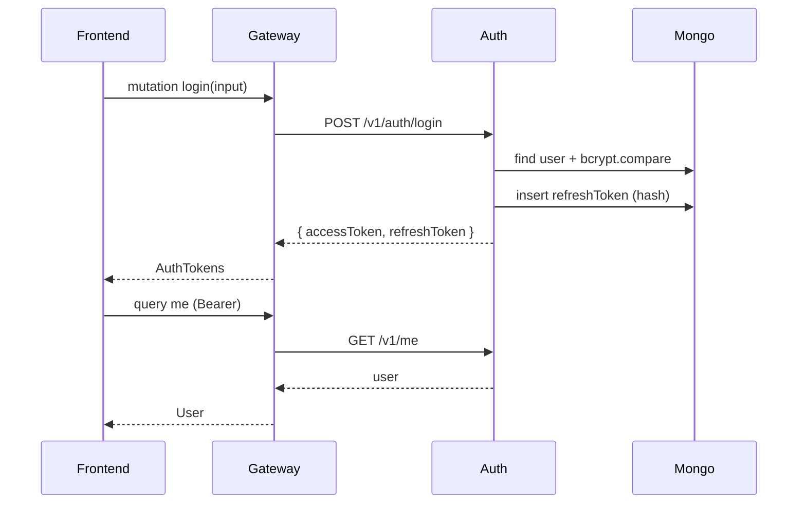

## 12.2 Request autenticada

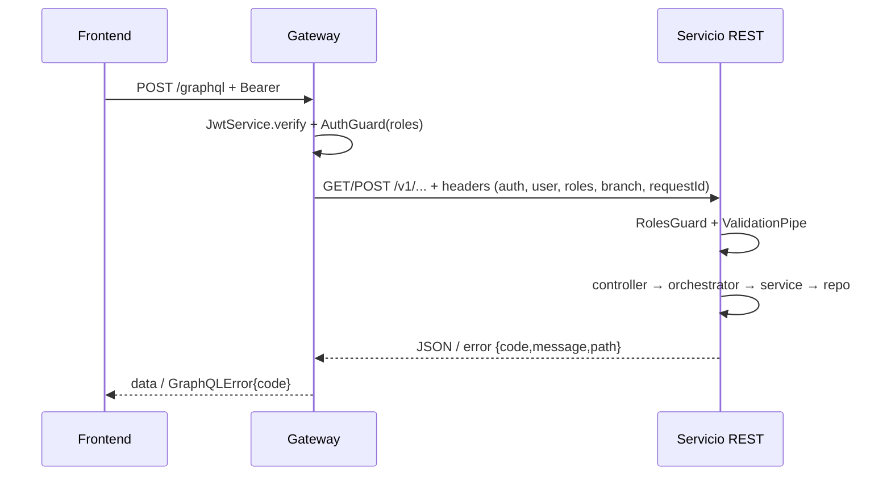

## 12.3 Creación de pedido

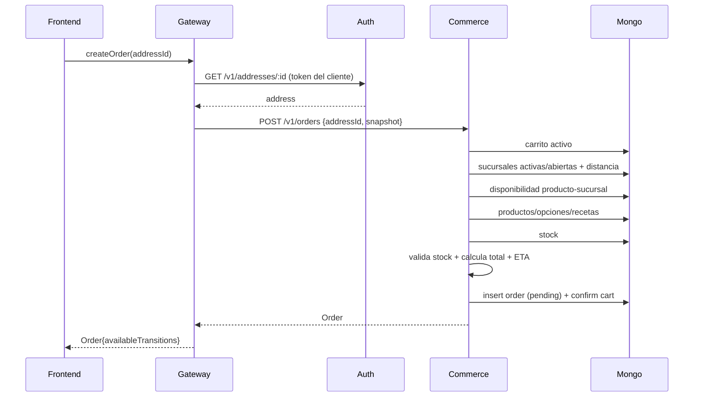

## 12.4 Cambio de estado + evento

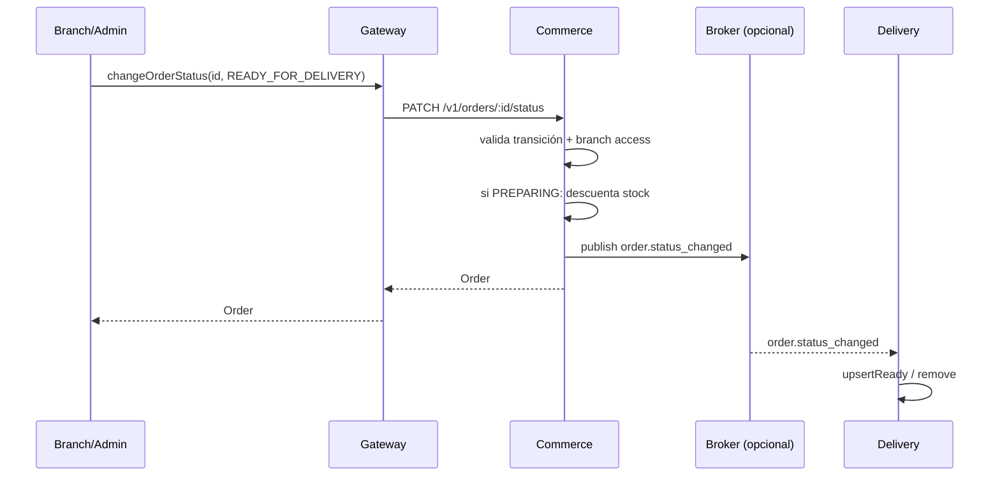

## 12.5 Oferta → entrega

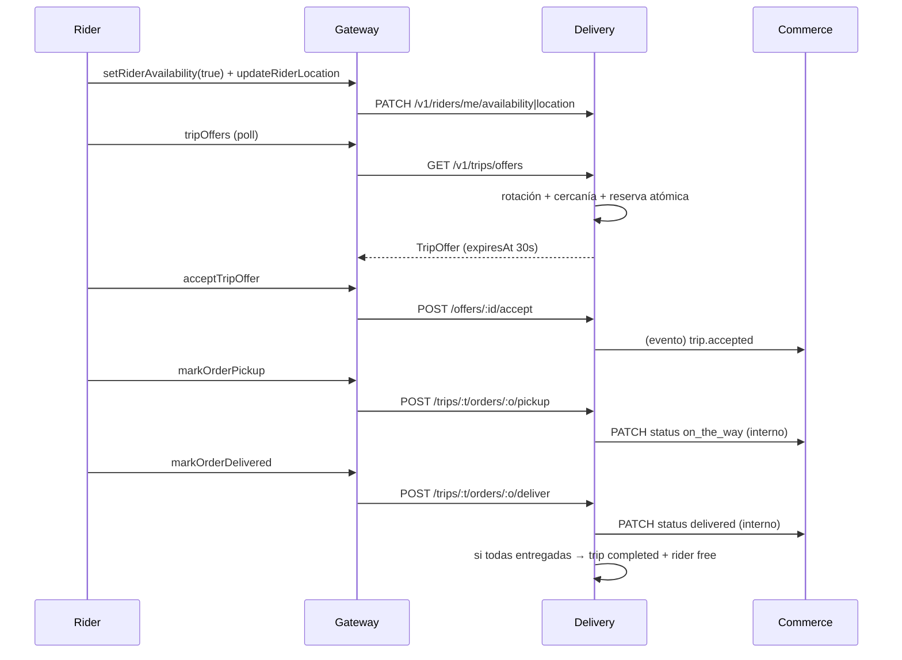

## 12.6 Recuperación de contraseña

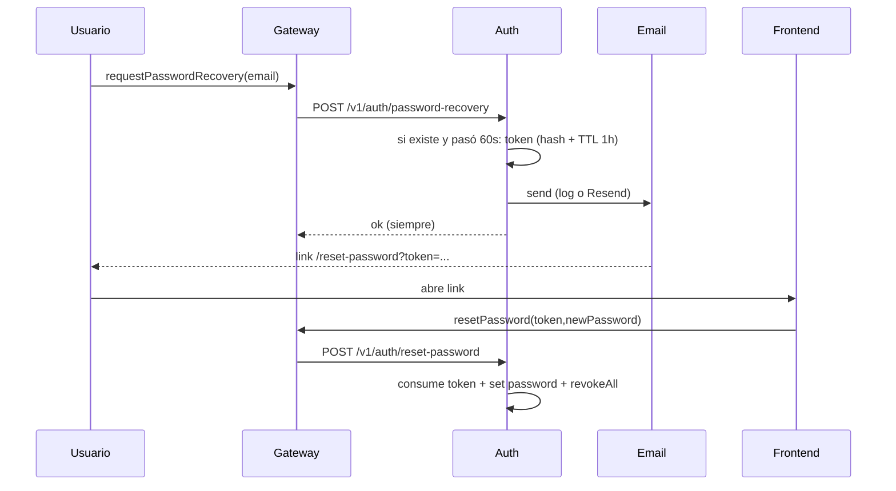

---

# 13. Algoritmos y reglas

## 13.1 Haversine

```text
haversine(a, b):
  dLat = rad(b.lat - a.lat)
  dLng = rad(b.lng - a.lng)
  h = sin(dLat/2)² + cos(rad(a.lat))·cos(rad(b.lat))·sin(dLng/2)²
  return 2 · 6371 · asin(sqrt(h))    # km
```

Se usa en:

- cobertura de sucursales (`findAvailable` / `findInZone`);
- matching de ofertas (rider→sucursal);
- ruta de un trip (pickup/delivery);
- (frontend) proximidad de 50 m para habilitar pickup/deliver.

## 13.2 ETA

```text
etaMin = BASE_PREP_MIN + round(distanceKm / AVG_SPEED_KMH * 60)
estimatedDeliveryAt = now + etaMin minutos
```

- `distanceKm` = Haversine sucursal → dirección de entrega.
- No modela tráfico, cantidad de ítems ni carga de la sucursal.

## 13.3 Selección de sucursal

```text
branches = activas
  .filter(abiertaAhora(hours, TZ Buenos Aires))
  .filter(haversine(entrega, sucursal) <= MAX_DISTANCE_KM)
  .sort(por distancia)
branch = branches[0]
```

Sin balanceo de carga, sin capacidad, sin fallback por stock.

## 13.4 Requerimientos de ingredientes

```text
para cada ítem del carrito:
  para cada entry de product.recipe:
    adjustment = entry.optionAdjustments.find(a => optionIds.includes(a.optionId))
    perUnit = adjustment ? adjustment.quantity : entry.quantity
    requirements[ingredientId] += perUnit * item.quantity
```

- Los ajustes por opción permiten, por ejemplo, “sin cebolla” o “doble queso”.
- Si dos ítems usan el mismo ingrediente, se acumula.
- La validación compara contra `branchStock`; el descuento ocurre al pasar a `preparing`.

## 13.5 Rotación de ofertas

```text
roster = riders activos (free, no stale, con ubicación)
         .filter(dist(rider, sucursal) <= MAX_MATCH_DISTANCE_KM)
         .sort(por distancia)
index = 0
turnUntil = now + 45s

mientras el rider del índice no sea el que consulta:
  si el rider del índice está activo y su ventana no venció → no es tu turno
  avanzar índice
  si se completó la vuelta:
     refrescar roster (nuevos primero, luego existentes)
     index = 0
     turnUntil = now + 45s
```

- La rotación es **por pedido** (`deliveryOrder`), no global.
- Al liberar una reserva vencida o rechazar, se avanza el turno.
- El “nuevo primero” evita que los riders habituales bloqueen a los recién conectados.

## 13.6 Ruta y ganancia

```text
routeKm = 0; prev = rider.location
para cada orden seleccionada (por cercanía a la sucursal):
  routeKm += dist(prev, branchLocation)
  routeKm += dist(branchLocation, deliveryAddress)
  prev = deliveryAddress

distanceKm = round(routeKm, 2)
earnings = round(BASE + PER_KM * distanceKm + PER_ORDER * orderCount)
```

- No optimiza el orden de entregas (ni TSP ni heurística): respeta el orden de cercanía al pick-up.
- `earnings` se congela al completar el trip (`earnings = estimatedEarnings`).

## 13.7 Número de pedido

```text
number = String(countDocuments() + 1).padStart(6, '0')
```

- Simple y legible (`000123`), pero **no resistente a concurrencia**.
- El índice único protege la integridad, no la experiencia: un choque produce error 500.

## 13.8 Reportes

- `overview`: `$facet` con `sales`, `status`, `series`, `topProducts`, `branchPerformance`.
- `series`: `$dateToString` con `timezone: America/Argentina/Buenos_Aires`.
- `variation`: `(actual - anterior) / anterior * 100`, `null` si anterior = 0.
- `best-sellers`/`highest-revenue`: excluyen productos sin ventas.
- `least-sold`: incluye productos sin ventas.
- `out-of-stock`: mínimo stock de la receta ≤ 0.

---

# 14. Validaciones

## 14.1 DTOs (class-validator)

- `ValidationPipe` global con `whitelist` y `transform` en los tres servicios REST.
- El gateway **no** tiene ValidationPipe global: valida tipos/estructura por el esquema GraphQL y delega el resto a los DTOs.
- Ejemplos:
  - `RegisterDto`: email válido, password 8–128, nombres ≤100, teléfono ≤50.
  - `AddCartItemDto`: `quantity` entero ≥1, observaciones ≤500, `optionIds` string[].
  - `AdjustStockDto`: `delta` numérico (puede ser negativo).
  - `OrderQueryDto`: estado dentro del enum, `limit` 1–100, `offset` ≥0.
  - `BranchCoordsQueryDto`: lat/lng numéricos.
  - `CreateConfigGroupDto`: tipo válido, `required` booleano, `min` obligatorio si `required`, `max` coherente.

## 14.2 Reglas de dominio

| Regla                                           | Dónde           | Error                                |
| ----------------------------------------------- | --------------- | ------------------------------------ |
| Email único                                     | auth            | `409 EMAIL_TAKEN`                    |
| Usuario activo para login                       | auth            | `403 USER_INACTIVE`                  |
| Super admin no editable                         | auth            | `403 FORBIDDEN`                      |
| `branchId` existe al crear/editar staff         | auth → commerce | `404 BRANCH_NOT_FOUND` / `502`/`503` |
| Categoría existe al crear/editar producto       | commerce        | `404 CATEGORY_NOT_FOUND`             |
| Ingrediente existe en receta                    | commerce        | `404 INGREDIENT_NOT_FOUND`           |
| Receta: cantidades > 0                          | commerce        | `400 VALIDATION_ERROR`               |
| Receta: ajustes apuntan a opciones del producto | commerce        | `404 OPTION_NOT_FOUND`               |
| Ingrediente en uso no se desactiva              | commerce        | `409 INGREDIENT_IN_USE`              |
| Producto disponible                             | commerce        | `400 PRODUCT_UNAVAILABLE`            |
| Opción disponible                               | commerce        | `400 PRODUCT_UNAVAILABLE`            |
| Carrito no vacío                                | commerce        | `400/404 CART_NOT_FOUND`             |
| Transición válida                               | commerce        | `409 INVALID_TRANSITION`             |
| Stock suficiente al crear                       | commerce        | `409 INSUFFICIENT_STOCK`             |
| Sucursal disponible                             | commerce        | `409 NO_BRANCH_AVAILABLE`            |
| Pedido accesible por rol/sucursal/cliente       | commerce        | `404 ORDER_NOT_FOUND`                |
| Rider disponible y fresco                       | delivery        | `409 RIDER_OFFLINE`                  |
| Ubicación del rider                             | delivery        | `409 LOCATION_REQUIRED`              |
| Oferta propia, vigente y `offered`              | delivery        | `404/409`                            |
| Viaje propio y `active`                         | delivery        | `404/409`                            |
| Orden pertenece al viaje                        | delivery        | `404 ORDER_NOT_IN_TRIP`              |
| Orden `ready_for_delivery` para pickup          | delivery        | `409 INVALID_TRIP_STATUS`            |
| Orden `on_the_way` para deliver                 | delivery        | `409 INVALID_TRIP_STATUS`            |

## 14.3 Qué se valida en backend vs frontend

- **Backend (autoridad):** stock, precio final, disponibilidad, sucursal, transiciones, asignación de rider, ownership, roles, expiración de tokens/ofertas.
- **Frontend (UX):** botones deshabilitados, cálculo visual de totales, countdown, proximidad de 50 m, filtros.

> La única regla de negocio que hoy vive **sólo** en el frontend es la proximidad de 50 m para pickup/deliver. El backend no la replica.

---

# 15. Errores

## 15.1 Contrato REST

```json
{
  "code": "INSUFFICIENT_STOCK",
  "message": "Stock insuficiente para el ingrediente ...",
  "path": "/v1/orders"
}
```

- `DomainException` → status + `code` propio.
- `HttpException` → status + `code` mapeado (`VALIDATION_ERROR`, `UNAUTHENTICATED`, `FORBIDDEN`, `NOT_FOUND`, `CONFLICT`, `UNPROCESSABLE_ENTITY`, `TOO_MANY_REQUESTS`, `PAYLOAD_TOO_LARGE`, `INVALID_IMAGE_TYPE`).
- `CastError` → `404 NOT_FOUND`.
- Cualquier otra excepción → `500 INTERNAL_SERVER_ERROR` con mensaje genérico (no filtra stack).

## 15.2 Errores GraphQL

- `extensions.code` = código del servicio o `INTERNAL_SERVER_ERROR`.
- `extensions.path` = path REST que falló, si el servicio lo devolvió.
- `message` = mensaje del servicio.
- Throttling → `TOO_MANY_REQUESTS`.
- Guard → `UNAUTHENTICATED` / `FORBIDDEN` (verificado por e2e).

## 15.3 Errores de red entre gateway y servicios

`RestClient` no captura `fetch` errors: si el servicio está caído, el resolver lanza y el formatter devuelve `INTERNAL_SERVER_ERROR` (no hay reintentos ni circuit breaker).

## 15.4 Particularidades

- El gateway **descarta** `httpStatus` del error REST.
- `Auth` responde `404` para recursos inexistentes y `401`/`403` para auth.
- `Orders` responde `404` (no `403`) cuando el usuario no puede ver el pedido, para no filtrar existencia.

---

# 16. Observabilidad y operación

- **Request ID:** middleware en las 4 apps. Si llega `x-request-id`, se propaga; si no, se genera un UUID. Se devuelve en el header de respuesta y se reenvía a los servicios.
- **Logs:** Logger estándar de Nest (`Bootstrap`, `Seed`, errores de handlers, email, Cloudinary). No hay logger estructurado ni correlación automática de logs por request-id.
- **Health:** `GET /health` en las 4 apps. El del gateway devuelve `{ status, service, uptimeSeconds, timestamp, services: {auth, commerce, delivery} }`; **no verifica dependencias** (no pinga Mongo ni los servicios).
- **Métricas/tracing:** no hay.
- **Seed:** logs por entidad creada.
- **Arranque:** `npm run dev` (Turborepo), `npm run build`, `npm run start:prod` por app.

---

# 17. Testing

- **163 archivos `.spec.ts`** (unitarios) y **51 `.e2e-spec.ts`**.

| App      | Unitarios | E2E |
| -------- | --------: | --: |
| gateway  |        33 |  23 |
| commerce |        59 |  16 |
| delivery |        39 |   5 |
| auth     |        32 |   7 |

Cobertura destacada (verificada por nombres de archivos y casos):

- Gateway: matriz de autorización, seguridad, auth, comercio, delivery, errores downstream, fields nulos, DataLoader, upload, throttling, seed, health.
- Commerce: catálogo, productos/recetas, carrito, pedidos/transiciones, stock, reportes, seed, upload, seguridad.
- Delivery: ofertas, rotación, reservas, trips, rider, idempotencia de eventos, zonas/turnos, seed.
- Auth: registro/login, refresh, recuperación, usuarios/staff, direcciones, email, seguridad.
- Los e2e de los servicios están preparados para MongoDB en memoria (`mongodb-memory-server` en devDependencies) y los del gateway usan dobles HTTP para downstreams (`apps/gateway/test/downstream.ts`).

Comandos:

```bash
npm run test                                   # todos
npm run test --workspace @repo/gateway         # unitarios de un app
npm run test:e2e --workspace @repo/gateway     # e2e de un app
npm run lint
npm run typecheck
```

---

# 18. Configuración y deployment

## 18.1 Scripts (raíz)

```bash
npm install
npm run dev            # turbo run dev (4 apps en paralelo)
npm run build          # turbo run build
npm run lint
npm run typecheck
npm run test
npm run seed           # seed directo a Mongo (commerce → auth → delivery)
npm run format
```

Cada app: `dev`, `build`, `start`, `start:prod`, `lint`, `typecheck`, `test`, `test:e2e`, `seed` (auth/commerce/delivery).

## 18.2 Variables de entorno

| Variable                                                         | App                    | Default                              | Uso                                            |
| ---------------------------------------------------------------- | ---------------------- | ------------------------------------ | ---------------------------------------------- |
| `PORT`                                                           | todas                  | 4000/4201/4202/4203                  | puerto                                         |
| `NODE_ENV`                                                       | todas                  | development                          | playground/introspección y avisos de seguridad |
| `MONGODB_URI`                                                    | auth/commerce/delivery | `mongodb://localhost:27017/fastfood` | base                                           |
| `JWT_SECRET`                                                     | todas                  | `dev-secret-change-me`               | firma/verificación                             |
| `INTERNAL_API_TOKEN`                                             | todas                  | `dev-internal-token`                 | llamadas internas                              |
| `AUTH_SERVICE_URL`                                               | gateway/delivery       | `http://localhost:4201`              |                                                |
| `COMMERCE_SERVICE_URL`                                           | gateway/auth/delivery  | `http://localhost:4202`              |                                                |
| `DELIVERY_SERVICE_URL`                                           | gateway                | `http://localhost:4203`              |                                                |
| `THROTTLE_TTL_MS` / `THROTTLE_LIMIT`                             | gateway                | 60000 / 100                          | rate limit                                     |
| `JWT_ACCESS_EXPIRES_IN`                                          | auth                   | `15m`                                | access token                                   |
| `JWT_REFRESH_EXPIRES_IN`                                         | auth                   | `7d`                                 | refresh token                                  |
| `PASSWORD_RECOVERY_EXPIRES_IN`                                   | auth                   | `1h`                                 | token de reset                                 |
| `PASSWORD_RECOVERY_MIN_INTERVAL`                                 | auth                   | `60s`                                | anti-spam                                      |
| `EMAIL_PROVIDER`                                                 | auth                   | `log`                                | `log` o `resend`                               |
| `EMAIL_FROM`                                                     | auth                   | `Food Bosco <no-reply@...>`          | remitente                                      |
| `RESEND_API_KEY`                                                 | auth                   | —                                    | obligatorio si `resend`                        |
| `STORE_URL` / `ADMIN_URL` / `BRANCH_URL` / `RIDER_URL`           | auth                   | 5173/5174/5175/5176                  | links de reset por rol                         |
| `PASSWORD_RESET_PATH`                                            | auth                   | `/reset-password`                    |                                                |
| `BROKER_URL`                                                     | commerce/delivery      | vacío                                | RabbitMQ; vacío = in-process                   |
| `RIDER_STALE_AFTER_MS`                                           | delivery               | 300000                               | staleness                                      |
| `OFFER_TTL_SECONDS`                                              | delivery               | 30                                   | vida de la oferta                              |
| `SAME_RIDER_COOLDOWN_SECONDS`                                    | delivery               | 45                                   | ventana de rotación                            |
| `EARNINGS_BASE` / `EARNINGS_PER_KM` / `EARNINGS_PER_ORDER`       | delivery               | 500 / 200 / 300                      | ganancia estimada                              |
| `MAX_MATCH_DISTANCE_KM`                                          | delivery               | 8                                    | radio de matching                              |
| `AVG_SPEED_KMH`                                                  | delivery               | 25                                   | ETA de viaje                                   |
| `MAX_ORDERS_PER_TRIP`                                            | delivery               | 3                                    | multi-pedido                                   |
| `UPLOAD_MAX_SIZE_BYTES`                                          | gateway/commerce       | 5 MB                                 | upload                                         |
| `CLOUDINARY_CLOUD_NAME` / `_API_KEY` / `_API_SECRET` / `_FOLDER` | commerce               | —                                    | uploads                                        |
| `SEED_PARAM_MAX_DISTANCE_KM` / `BASE_PREP_MIN` / `AVG_SPEED_KMH` | commerce               | 10 / 15 / 25                         | defaults de parámetros                         |
| `SEED_*_PASSWORD`, `SEED_*_EMAIL`, etc.                          | auth                   | ver §18.4                            | seed                                           |

## 18.3 Resolución de URLs

- El gateway usa `AUTH_SERVICE_URL`, `COMMERCE_SERVICE_URL`, `DELIVERY_SERVICE_URL`.
- Auth y delivery usan `COMMERCE_SERVICE_URL`; delivery también `AUTH_SERVICE_URL`.
- En local, todo apunta a `localhost` con los puertos por defecto.

## 18.4 Seed y credenciales

```bash
# vía HTTP (requiere los 4 servicios arriba)
curl -X POST http://localhost:4000/seed -H "x-internal-token: dev-internal-token"

# directo a Mongo (no requiere servicios)
npm run seed
```

Credenciales (`docs/credenciales-seed.md`):

| Email                             | Rol          | Password                      |
| --------------------------------- | ------------ | ----------------------------- |
| `admin@foodbosco.local`           | super_admin  | `Admin123!`                   |
| `cliente@foodbosco.local`         | customer     | `Cliente123!`                 |
| `repartidor@foodbosco.local`      | rider        | `Repartidor123!`              |
| `sucursal@foodbosco.local`        | branch_admin | `Sucursal123!` (sin sucursal) |
| `sucursal.centro@foodbosco.local` | branch_admin | `Sucursal123!` (Centro)       |
| `sucursal.norte@foodbosco.local`  | branch_admin | `Sucursal123!` (Norte)        |
| `sucursal.oeste@foodbosco.local`  | branch_admin | `Sucursal123!` (Oeste)        |

**Ojo con la diferencia entre los dos caminos** (verificado en `apps/*/src/seed/seed.ts`):

- **`npm run seed` (directo a Mongo):** commerce crea catálogo, sucursales, stock, promociones, parámetros y estados (sin pedidos); auth crea `super_admin`, `customer`, `rider` y las direcciones del cliente (**no** crea branch admins, porque no recibe las sucursales); delivery crea zonas, turnos y el perfil del rider (sin pedido listo).
- **`POST /seed` (gateway, con los servicios arriba):** encadena los tres seeds pasándose datos; crea **un branch_admin por sucursal**, los **pedidos de ejemplo** y, si hay un pedido `ready_for_delivery`, lo inserta en el pool de delivery.

Para una demo completa del flujo de reparto conviene usar el seed vía gateway (o levantar RabbitMQ y mover un pedido a `ready_for_delivery`).

## 18.5 Deployment

- **No hay Dockerfile, docker-compose ni manifiestos de deploy en el repo.** El despliegue es externo (el frontend apunta al gateway).
- Requisitos: Node ≥ 20, MongoDB accesible, variables de entorno.
- **No hay OpenAPI/Swagger** generado ni publicado.
- **No hay migraciones**: Mongoose crea índices al inicializar los modelos.
- Para producción harían falta, como mínimo: secretos fuertes, TLS, red privada para los servicios REST, broker, backups, observabilidad y límites de recursos.

---

# 19. Seguridad

## 19.1 Bien implementado

- **Contraseñas con bcrypt** (10 rounds) y `passwordHash` con `select: false`.
- **Refresh tokens opacos**, hasheados con SHA-256, de un solo uso, con TTL e índice único.
- **Rotación de refresh** y revocación global en logout/reset.
- **Recuperación de contraseña neutral** (no revela si el email existe), token de un solo uso, TTL 1 h, mínimo 60 s entre solicitudes.
- **RBAC en dos capas**: gateway (roles) + servicios (roles/ownership/sucursal).
- **Scoping por `branchId`** en órdenes, stock, reportes y sucursales.
- **Token interno** para rutas servicio-a-servicio.
- **Rate limiting** global y específico para recuperación/reset.
- **Uploads** con límite de tamaño y validación de tipo (gateway + commerce).
- **Errores genéricos** en 500 (no filtra stack).
- **Sin `dangerouslySetInnerHTML`** no aplica; el backend no renderiza HTML de usuario.
- **GraphQL**: introspección/playground off en producción; el esquema no tiene ciclos que permitan profundidad infinita.

## 19.2 Limitaciones y riesgos (para defender con honestidad)

| Riesgo                                        | Detalle                                                                                                                                        | Mitigación actual / recomendación                                   |
| --------------------------------------------- | ---------------------------------------------------------------------------------------------------------------------------------------------- | ------------------------------------------------------------------- |
| **Servicios REST expuestos**                  | `enableCors()` abierto en las 4 apps; si los puertos 4201–4203 son públicos, se puede llamar directo y saltear el rate limit del gateway       | Red privada / firewall; sólo el gateway público                     |
| **Confianza en el gateway para la dirección** | `POST /v1/orders` no valida ownership de `addressId`; el gateway sí lo resuelve antes                                                          | Mantener servicios no públicos; validar también en commerce         |
| **Secretos por defecto**                      | `JWT_SECRET` e `INTERNAL_API_TOKEN` tienen defaults; en producción sólo se emite `console.warn` (no falla)                                     | Fijar secretos reales; el warning no es bloqueante                  |
| **Endpoint `/seed` expuesto**                 | `POST /seed` sólo está protegido por `x-internal-token`; con el default conocido, cualquiera con acceso al gateway puede recrear datos de demo | Deshabilitarlo en producción o exigir un token fuerte y red privada |
| **JWT sin revocación**                        | Un access token sigue válido hasta 15 min aunque el usuario se desactive o cambie de rol                                                       | TTL corto; refresh bloqueado; considerar denylist                   |
| **Sin `iss`/`aud`/`kid`**                     | Firma HS256 simple                                                                                                                             | Añadir claims y rotación de claves si escala                        |
| **Proximidad sólo en frontend**               | Pickup/deliver no validan distancia ni frescura de ubicación                                                                                   | Validar en delivery (Haversine + `lastSeenAt`)                      |
| **Sin bloqueo por cuenta**                    | Login sólo limitado por IP/token (100/min global)                                                                                              | Añadir rate limit por email/cuenta                                  |
| **Rate limit por token, no por usuario**      | El tracker usa el header `Authorization` completo; rotar access tokens multiplica el cupo                                                      | Keyear por `userId` cuando esté autenticado                         |
| **CORS abierto**                              | Cualquier origen puede llamar a los servicios                                                                                                  | Restringir orígenes en el gateway                                   |
| **Sin HTTPS/helmet**                          | Depende del proxy/deploy                                                                                                                       | TLS + headers de seguridad en el borde                              |
| **Sin auditoría de acciones**                 | Sólo `stockMovements` y `statusHistory`                                                                                                        | Log de auditoría por operación                                      |
| **Upload MIME spoofable**                     | El gateway confía en `file.mimetype`; commerce revalida y Cloudinary procesa                                                                   | Validación por magic bytes si se requiere                           |
| **Seed credentials**                          | Credenciales conocidas y commiteadas                                                                                                           | Sólo desarrollo; rotar en prod                                      |
| **Errores internos**                          | Algunos mensajes incluyen ids (p. ej. ingrediente)                                                                                             | Aceptable para operación; no exponer detalles al cliente final      |

## 19.3 Comparación con el frontend

- El frontend guarda tokens en `localStorage` (XSS); el backend no puede mitigarlo salvo cookies httpOnly (no implementadas).
- El backend firma tokens sin `iss/aud`; el frontend no los decodifica.
- El backend no confía en el frontend para permisos: cada servicio revalida.

---

# 20. Límites, riesgos y deuda técnica

## 20.1 Lo que el backend **no** hace

- **Pagos**: no hay pasarela ni estado de pago.
- **Facturación/impuestos**: `total` es sólo ítems.
- **Costo de envío**: no se calcula ni se cobra.
- **Promociones aplicadas**: el CRUD existe, pero no descuenta.
- **Push/email transaccional de pedidos**: sólo email de recuperación.
- **WebSockets/SSE**: el tiempo real es polling del frontend.
- **Geocoding**: el frontend usa Geoapify; el backend recibe lat/lng.
- **Optimización de rutas**: la ruta es secuencial por cercanía al pick-up.
- **Zonas/turnos en el matching**: existen como CRUD, no asignan.
- **Prueba de entrega**: no hay foto/firma/código.
- **Liquidación a riders**: sólo `earnings` estimado/registrado.
- **Auditoría general**: no hay log de acciones administrativas.

## 20.2 Riesgos técnicos concretos

1. **Sin transacciones** en creación de pedido, descuento de stock ni reserva de ofertas (la reserva sí es atómica por `updateMany`, pero el stock no).
2. **Sobreventa posible** por lectura-y-escritura no atómica del stock.
3. **Número de pedido por `count()+1`**: colisión bajo concurrencia.
4. **Carrito sin unicidad** `(clientId,status)`: posible doble carrito activo.
5. **Eventos cross-service requieren RabbitMQ**; sin broker, delivery no recibe pedidos listos.
6. **Publicación de eventos sin confirmación** en commerce (`noAck: true`): un fallo del broker puede perder eventos o hacer fallar el cambio de estado después de persistirlo.
7. **DataLoader no batch real**: deduplica, pero no reduce requests a uno por lote.
8. **Cancelación no repone stock**.
9. **Sin fallback de sucursal** por stock.
10. **Proximidad de pickup/deliver sólo en frontend**.
11. **Servicios REST sin red privada** (riesgo de exposición).
12. **Secretos por defecto** con warning no bloqueante.
13. **Sin revocación de access tokens**.
14. **`orderStates` no gobierna transiciones**.
15. **Promociones y zonas/turnos son CRUD sin efecto**.

## 20.3 Cosas que no preguntaste (pero conviene saber)

1. **`seed-utils`**: paquete compartido con carga de JSON, `insertIfAbsent`/`upsertOne` y `runSeed`; hace que los seeds sean idempotentes por clave natural.
2. **`processedEvents`**: además del `eventId` único, tiene un **TTL de 7 días** para que la colección de dedupe no crezca sin límite.
3. **Request ID**: se genera/propaga en las 4 apps; si el cliente manda `x-request-id`, se respeta. Útil para correlacionar logs aunque hoy no se indexe.
4. **`CastError` → 404**: un id que no es ObjectId no produce 500; el filtro global lo traduce a `NOT_FOUND`.
5. **`stockMovements`**: cada ajuste/descuento deja un movimiento con `delta`, `reason` y `orderId`; es la trazabilidad más cercana a una auditoría de stock.
6. **Horarios que cruzan medianoche**: `closing < opening` se interpreta como turno nocturno, y se contempla la entrada del día anterior.
7. **Disponibilidad producto-sucursal por defecto `true`**: si no hay fila para el par, el producto está disponible; sólo una fila explícita `false` lo bloquea.
8. **Perfil de rider on-demand**: no se crea al registrarse; se crea la primera vez que el rider consulta `/v1/riders/me`, leyendo sus datos de auth.
9. **`normalizeVehicle`**: el vehículo histórico es un string; si contiene “bici” se interpreta bici, si no, moto.
10. **Máximo de pedidos por viaje**: `MAX_ORDERS_PER_TRIP=3`; el rider puede llevar varios pedidos en una misma ruta.
11. **`order.number`**: 6 dígitos con padding (`000123`), generado por conteo.
12. **`EMAIL_PROVIDER=log`**: en desarrollo el mail de recuperación se imprime en el log del servicio auth (sirve para probar el flujo sin Resend).
13. **`orderStates`**: se siembran 7 estados y el admin puede editarlos, pero la máquina de estados efectiva sigue en `ORDER_TRANSITIONS`.
14. **Playground**: disponible en `http://localhost:4000/graphql` sólo fuera de producción.
15. **El gateway descarta `httpStatus`**: el error GraphQL conserva `code` y `path`, pero no el status HTTP original.
16. **El rate limit del gateway se keyea por el header `Authorization` completo** (o IP si no hay token), no por `userId`.
17. **`TripOrder.order` existe en el esquema GraphQL**, pero el frontend del rider no lo consulta (usa los datos del trip); sí lo puede usar otro cliente.
18. **El evento `trip.completed` se publica aunque commerce no haga nada con él**: queda como punto de extensión (notificaciones, liquidaciones, métricas).

---

# 21. Código real por encima de documentación

Inconsistencias verificadas (el código es la verdad):

| #   | Documento dice                                                                                                                                  | El código hace                                                                                                                                                                   |
| --- | ----------------------------------------------------------------------------------------------------------------------------------------------- | -------------------------------------------------------------------------------------------------------------------------------------------------------------------------------- |
| 1   | `fundamentacion-gateway-graphql-rest.md` §1: “**cinco frontends** (`apps/auth`, `apps/store`, `apps/admin`, `apps/admin-global`, `apps/rider`)” | El repo de frontend tiene **4 apps** (`store`, `admin`, `branch`, `rider`); `auth` es un **paquete** (`packages/auth`), no una app.                                              |
| 2   | `fundamentacion` §3: “el SDL se genera/exporta y se codegene en TypeScript para `@repo/domain`”                                                 | El gateway usa `autoSchemaFile: true` (SDL en memoria); no hay archivo SDL ni codegen en el repo.                                                                                |
| 3   | `fundamentacion` §6: “comunicación asíncrona por broker (**RabbitMQ/Kafka**)”                                                                   | Sólo **RabbitMQ** (`amqplib`), y es **opcional**: sin `BROKER_URL` usa `InProcessTransport`. No hay Kafka.                                                                       |
| 4   | `fundamentacion` §4/§6: “servicios documentados con **OpenAPI**”                                                                                | No hay `@nestjs/swagger`, `SwaggerModule` ni spec OpenAPI en el repo.                                                                                                            |
| 5   | `docs/credenciales-seed.md`: “En producción el arranque **falla** si los secretos quedan en sus valores por defecto”                            | Los cuatro `env.ts` sólo emiten `console.warn`; **no** abortan el arranque.                                                                                                      |
| 6   | `fundamentacion` §3: “**DataLoader** agrupa y deduplica las llamadas REST internas”                                                             | Deduplica claves por request, pero `buildByIdLoader` hace **un `GET` por id** (`Promise.all`); no hay endpoint batch.                                                            |
| 7   | Documentación funcional sugiere estados configurables                                                                                           | `ORDER_TRANSITIONS` está **hardcodeado**; `orderStates` es sólo catálogo de UI.                                                                                                  |
| 8   | Documentación funcional incluye promociones                                                                                                     | `promotions` es CRUD; **no** se aplica a carrito/pedido.                                                                                                                         |
| 9   | Documentación funcional incluye zonas/turnos de delivery                                                                                        | `zones`/`shifts` son CRUD; el matching usa **distancia + disponibilidad + staleness**, no zonas/turnos.                                                                          |
| 10  | Guía del frontend: registro permite `customer` o `rider`                                                                                        | El backend exige **super_admin** para `register-rider` y `POST /v1/users/riders`; un rider no puede auto-registrarse desde la app.                                               |
| 11  | Guía del frontend: `dayOfWeek` 1–7                                                                                                              | El backend usa **0 = domingo … 6 = sábado** (`getUTCDay`), y el seed genera 0–6.                                                                                                 |
| 12  | “Frontend habla únicamente GraphQL”                                                                                                             | El frontend usa **`POST /v1/uploads`** (REST del gateway) para subir imágenes.                                                                                                   |
| 13  | `docs/credenciales-seed.md` sugiere que el seed crea todo (incluidos branch admins, pedidos y pedido listo)                                     | El **seed directo** (`npm run seed`) no crea branch admins, pedidos ni pedido listo; eso ocurre sólo con **`POST /seed`** del gateway, que pasa sucursales y contexto de pedido. |

> Estas diferencias no rompen la demo, pero conviene mencionarlas si preguntan “¿esto está documentado así?”. La respuesta correcta es: **el código manda**.

---

# Qué tengo que saber para la demo

## 🔴 CRÍTICO — Poder explicarlo sin dudar

1. Hay **4 apps NestJS**: gateway GraphQL (4000, sin DB) + auth (4201) + commerce (4202) + delivery (4203), todas con MongoDB.
2. El gateway **no tiene lógica de negocio**: valida JWT/roles, aplica rate limit, traduce a REST y compone con DataLoaders.
3. **Regla de oro:** un servicio primario no llama a otro; coordina el **orchestrator**.
4. **Auth:** JWT access 15 min + refresh opaco hasheado, de un solo uso, 7 días; logout/reset revocan todo.
5. **RBAC en dos capas** + scoping por `branchId`/`clientId`/`riderId` en los servicios.
6. **Un solo endpoint GraphQL** (`POST /graphql`) y REST interno `/v1` en cada servicio.
7. **Creación de pedido:** carrito server-side → sucursal más cercana abierta → disponibilidad → productos/opciones → stock → total + ETA → `Order` pendiente → carrito confirmado.
8. **La sucursal se asigna en backend**; el cliente sólo manda la dirección.
9. **Estados hardcodeados**: `pending → confirmed → preparing → ready_for_delivery → on_the_way → delivered` (+ `cancelled`), con `availableTransitions`.
10. **Stock:** se valida al crear y se descuenta al pasar a `preparing`.
11. **Delivery:** ofertas perezosas por polling, rotación por cercanía, reserva atómica, TTL 30 s, hasta 3 pedidos por viaje.
12. **Eventos:** `order.status_changed`, `trip.accepted`, `trip.completed`; RabbitMQ opcional; sin broker, el flujo cross-service no ocurre.
13. **Reportes:** agregaciones Mongo, 30 días por defecto, comparación con período anterior, timezone Buenos Aires.
14. **Seguridad:** bcrypt, tokens hasheados, token interno, throttling, validación de DTOs, ownership.
15. **Límites honestos:** no pagos, no promociones aplicadas, no zonas/turnos en matching, proximidad sólo en frontend, sin transacciones.

## 🟡 IMPORTANTE — Debería entenderlo

- `AuthGuard` del gateway vs `RolesGuard` de los servicios (metadata y precedencia).
- El gateway verifica el JWT una vez y propaga identidad por headers; los servicios **reverifican**.
- `@Internal()` no hace pública la ruta: exige token interno **o** JWT+rol.
- Diferencia entre `register` (customer) y `register-rider` (super_admin).
- Rotación de refresh y por qué el reuso falla.
- `PasswordRecovery` neutral + ventana de 60 s + TTL 1 h.
- Haversine y su uso en cobertura/matching/ruta.
- ETA: `BASE_PREP_MIN + distancia/velocidad`.
- Rotación de ofertas: roster, índice, ventana de 45 s, “nuevos primero”.
- Reserva atómica de pedidos y liberación por TTL.
- Idempotencia de eventos (`processedEvents`).
- Reportes: revenue sin cancelados, `variation` null si base 0.
- Seed: `npm run seed` vs `POST /seed`.

## 🟢 SECUNDARIO — Está bueno saberlo

- `stockMovements` como trazabilidad de ajustes/descuentos.
- `CastError → 404`.
- `order.number` de 6 dígitos.
- Horarios que cruzan medianoche.
- `branchProductAvailability` default `true` si no hay fila.
- `normalizeVehicle` (texto con “bici” → bici).
- `rider.status` (`offline/free/on_trip`) y `lastSeenAt`.
- `MAX_ORDERS_PER_TRIP=3` y `MAX_MATCH_DISTANCE_KM=8`.
- `trip.completed` se publica aunque commerce no haga nada.
- El frontend hace polling 15 s (ofertas), 5 s (pedidos entrantes) y 4 s (tracking).

## 🎬 Guion sugerido de demo (10 minutos)

> Pre-requisitos: MongoDB arriba, `npm run dev`, y `POST /seed` con `x-internal-token` para tener catálogo, usuarios y un pedido listo para reparto.

1. **Salud y arquitectura (1 min).** Abrir `/health` de las 4 apps; remarcar que el gateway no tiene DB y que los servicios sí.
2. **Seed (1 min).** `curl -X POST http://localhost:4000/seed -H "x-internal-token: dev-internal-token"`; mostrar el summary de commerce/auth/delivery. Mencionar que el seed inserta un pedido `ready_for_delivery` para el rider.
3. **Cliente (2 min).** `login` del cliente → `me` → `categories`/`products(filter:{lat,lng})` → `myAddresses`.
4. **Pedido (2 min).** `addCartItem` con una opción → `createOrder(addressId)`. Mostrar `number`, `status: PENDING`, `total`, `estimatedDeliveryAt`, `branchId`, `availableTransitions`.
5. **Sucursal (2 min).** Login con el `branch_admin` de la sucursal asignada → `changeOrderStatus(PREPARING)` (mostrar `branchStock` descontado) → `changeOrderStatus(READY_FOR_DELIVERY)`.
6. **Rider (2 min).** Login del rider → `setRiderAvailability(true)` → `updateRiderLocation` cerca de la sucursal → `tripOffers` → `acceptTripOffer` → `markOrderPickup` → `markOrderDelivered`.
7. **Cierre (1 min).** Consultar el pedido como cliente (`DELIVERED`), mostrar `reportsOverview`, y aclarar límites: sin broker no hay `riderLocation`; no hay pagos; promociones no aplicadas; proximidad sólo frontend.

> **Aclaración para el paso 6:** el pedido que toma el rider es el que el seed dejó en `ready_for_delivery`. El pedido nuevo del paso 5 no aparecerá en delivery **salvo que haya RabbitMQ** (`BROKER_URL`) y el evento `order.status_changed` cruce de commerce a delivery.

---

# 22. Preguntas que podrían hacerme

### 1. ¿Por qué un GraphQL Gateway y no REST directo?

**Corta:** para que el frontend haga **una** query por pantalla y el gateway componga relaciones cross-service (`Order.client`, `Order.branch`) sin que el cliente conozca la topología.

**Técnica:** el gateway traduce a REST, aplica auth/RBAC/rate limit y normaliza errores; los servicios quedan simples y dueños de sus datos.

### 2. ¿Por qué REST entre servicios y no GraphQL?

**Corta:** el gateway siempre quiere el recurso completo; la flexibilidad de GraphQL no aporta entre servicios.

**Técnica:** REST es más simple de depurar, encaja con NestJS y evita duplicar parsers/validadores. La fundamentación descarta Federation y gRPC por costo operativo.

### 3. ¿El gateway tiene lógica de negocio?

**Corta:** no. Sólo valida identidad/rol, limita requests, traduce y compone.

**Técnica:** la única “decisión” del gateway es resolver la dirección del cliente antes de crear el pedido (para armar el snapshot) y mapear enums/errores.

### 4. ¿Cómo se autentica una request?

**Corta:** `Authorization: Bearer <accessToken>`; el gateway verifica el JWT y arma el contexto.

**Técnica:** `buildContext` usa `JwtService.verify` (HS256 + exp) y expone `userId`, `roles`, `branchId`; los servicios vuelven a verificar el token con el mismo secreto.

### 5. ¿Dónde se guardan los tokens?

**Corta:** el access token no se guarda; el refresh se guarda **hasheado** en Mongo.

**Técnica:** `refreshTokens` con `tokenHash` SHA-256, `expiresAt` (TTL index), `revoked`; el valor crudo sólo lo tiene el cliente.

### 6. ¿Cómo se renueva la sesión?

**Corta:** `refreshToken` rota ambos tokens.

**Técnica:** `consume` revoca el refresh usado (`findOneAndUpdate revoked:false → true`), valida expiración y usuario activo, emite un access nuevo y un refresh nuevo. El reuso falla con `401`.

### 7. ¿Qué pasa si el usuario se desactiva?

**Corta:** no puede volver a loguearse ni refrescar; su access token sigue válido hasta 15 min.

**Técnica:** `verifyCredentials` y `refresh` chequean `active`; no hay denylist de access tokens.

### 8. ¿Cómo se hace logout?

**Corta:** revoca **todos** los refresh tokens del usuario.

**Técnica:** `POST /v1/auth/logout` → `revokeAllForUser(userId)`; el access token expira solo.

### 9. ¿Cómo se autoriza por rol?

**Corta:** el gateway exige roles por resolver; los servicios lo vuelven a exigir.

**Técnica:** `@Roles(...)` + `AuthGuard` (GraphQL) y `RolesGuard` global (REST); `@Authenticated` para “cualquier usuario”.

### 10. ¿Cómo evitás que un branch_admin vea otra sucursal?

**Corta:** el `branchId` sale del JWT y el servicio lo fuerza en cada consulta.

**Técnica:** `orders`, `stock`, `reporting` y `branches/:id/*` validan `auth.branchId`; si no coincide → `403` (o 404 en pedidos).

### 11. ¿Y si un customer manda otro `clientId`?

**Corta:** se ignora; el `clientId` se toma del token.

**Técnica:** `OrderController.create` usa `auth.userId`; en listados, customer fuerza `clientId = auth.userId`.

### 12. ¿Cómo se elige la sucursal de un pedido?

**Corta:** la más cercana, activa y abierta dentro del radio configurado.

**Técnica:** `findAvailable(lat,lng)` filtra activas, abiertas (`isBranchOpenNow` en TZ Buenos Aires), distancia ≤ `MAX_DISTANCE_KM`, ordena por Haversine y toma `[0]`.

### 13. ¿Qué pasa si no hay sucursal?

**Corta:** `409 NO_BRANCH_AVAILABLE`.

**Técnica:** el pedido no se crea; no hay fallback a sucursales más lejanas.

### 14. ¿Cómo se calcula el ETA?

**Corta:** preparación base + tiempo de viaje.

**Técnica:** `BASE_PREP_MIN + round(haversine(sucursal, entrega) / AVG_SPEED_KMH * 60)`; se guarda `estimatedDeliveryAt`.

### 15. ¿Cómo se calcula el total?

**Corta:** en el servidor, con precios actuales de productos y opciones.

**Técnica:** `unitPrice = product.price + Σ extraPrice`; `subtotal = unitPrice * qty`; `total = Σ subtotales`. No se aceptan precios del cliente.

### 16. ¿Se aplican promociones?

**Corta:** no. Hay CRUD, pero no se descuenta nada.

**Técnica:** ni `CartOrchestrator` ni `OrderOrchestrator` consultan `promotions`.

### 17. ¿Cómo se valida el stock?

**Corta:** al crear el pedido se valida; al pasar a `preparing` se descuenta.

**Técnica:** `buildOrderItems` acumula requerimientos por receta (con ajustes por opción) y `StockService.validateAvailability` compara contra `branchStock`. El descuento registra `stockMovements` con `reason=preparing`.

### 18. ¿Qué pasa si se cancela un pedido ya en preparación?

**Corta:** el stock **no** se repone.

**Técnica:** `changeStatus` sólo descuenta al entrar a `preparing`; no hay lógica inversa en `cancelled`.

### 19. ¿Hay transacciones?

**Corta:** no.

**Técnica:** no se usa `session`/`withTransaction`; la reserva de ofertas sí es atómica por `updateMany` condicional, pero el stock no.

### 20. ¿Cómo se genera el número de pedido?

**Corta:** contador + 1, con 6 dígitos.

**Técnica:** `countDocuments()+1`; el índice único evita duplicados, pero bajo concurrencia puede fallar con 500.

### 21. ¿Cómo se asignan los pedidos a los riders?

**Corta:** el rider consulta ofertas; el backend le arma una según cercanía y rotación.

**Técnica:** `listOffers` valida disponibilidad/staleness/ubicación, libera reservas vencidas, calcula el turno por `deliveryOrders`, selecciona hasta 3 pedidos, arma ruta/ganancia y reserva atómicamente.

### 22. ¿Por qué la oferta se genera al consultar?

**Corta:** no hay push; el frontend hace polling.

**Técnica:** el backend materializa la oferta en `GET /v1/trips/offers`; TTL 30 s. Sin polling no hay asignación.

### 23. ¿Cómo se evita que dos riders tomen el mismo pedido?

**Corta:** reserva atómica por `updateMany` sobre `status: ready`.

**Técnica:** si `matchedCount !== orderIds.length`, se libera y cancela el trip y se devuelve `[]`.

### 24. ¿Cómo funciona la rotación?

**Corta:** cada pedido tiene un roster de riders cercanos y un turno de 45 s.

**Técnica:** `rotationRoster/index/turnUntil`; si el rider del turno está inactivo o venció, avanza; al completar la vuelta se refresca el roster con los nuevos primero.

### 25. ¿Qué pasa si la oferta expira?

**Corta:** se libera el pedido y se cancela el trip.

**Técnica:** `expireStaleOffers` libera reservas vencidas y cancela trips `offered`; el siguiente poll puede generar otra oferta.

### 26. ¿Cómo se marca pickup/deliver?

**Corta:** el rider llama la mutación; delivery valida el trip/orden y actualiza commerce.

**Técnica:** `markPickup` exige trip `active` y orden `ready_for_delivery`; PATCH interno a commerce `on_the_way`; luego actualiza el trip. `markDeliver` exige `on_the_way`; si todas las órdenes están entregadas, completa el trip y libera al rider.

### 27. ¿Se valida que el rider esté cerca?

**Corta:** no en el backend; el límite de 50 m es del frontend.

**Técnica:** la API no compara `currentLocation` con pickup/delivery. Es una mejora pendiente.

### 28. ¿Qué pasa si commerce está caído en pickup?

**Corta:** la operación falla y el trip no avanza.

**Técnica:** `CommerceClient.patchOrderStatus` lanza si `!response.ok`; el `markPickup` no actualiza el trip si el PATCH falla.

### 29. ¿Cómo se comunican los servicios?

**Corta:** REST interno para lo sincrónico y eventos para lo asincrónico.

**Técnica:** gateway → servicios por REST; delivery → commerce/auth por REST interno con `x-internal-token`; commerce ⇄ delivery por RabbitMQ (o in-process si no hay broker).

### 30. ¿Qué eventos hay?

**Corta:** `order.status_changed`, `trip.accepted`, `trip.completed`.

**Técnica:** commerce publica el primero; delivery consume y publica los otros dos; commerce consume `trip.accepted` para asignar `tripId/riderId`.

### 31. ¿Cómo se evita procesar dos veces un evento?

**Corta:** delivery guarda `eventId` en `processedEvents` (TTL 7 días).

**Técnica:** aplica el efecto y luego marca; si falla, el broker reintenta y las escrituras son idempotentes.

### 32. ¿Qué pasa si no hay RabbitMQ?

**Corta:** los eventos no cruzan servicios; el flujo de delivery no se dispara solo.

**Técnica:** `MessagingModule` usa `InProcessTransport`; para la demo se siembra un pedido listo o se levanta RabbitMQ + `BROKER_URL`.

### 33. ¿Por qué no WebSockets?

**Corta:** el tracking se resolvió con polling moderado.

**Técnica:** no hay `@nestjs/websockets` ni SSE; el frontend consulta cada 4/5/15 s. Para tiempo real estricto habría que agregar subscriptions o WS.

### 34. ¿Cómo ve el cliente la ubicación del rider?

**Corta:** `Order.riderLocation` se resuelve en el gateway consultando delivery.

**Técnica:** `OrderFieldResolver.riderLocation` usa `order.riderId` y `GET /v1/riders/by-user/:id` (interno). Si no hay `riderId`, devuelve `null`.

### 35. ¿Cómo se reporta?

**Corta:** agregaciones de Mongo sobre `orders`, con filtros y comparación de períodos.

**Técnica:** `$facet` para overview; revenue sin cancelados; serie por día/semana/mes en TZ Buenos Aires; `variation` null si la base es 0.

### 36. ¿Cómo se manejan las imágenes?

**Corta:** el frontend sube a `POST /v1/uploads` (gateway) y se guarda en Cloudinary.

**Técnica:** el gateway valida `image/*` y 5 MB y reenvía a commerce; commerce valida jpg/png/webp/gif, tamaño y sube; devuelve `{url}`.

### 37. ¿Cómo se recupera una contraseña?

**Corta:** email con token de un solo uso; respuesta neutral.

**Técnica:** token opaco hasheado, TTL 1 h, mínimo 60 s entre solicitudes, link según rol; el reset revoca todas las sesiones.

### 38. ¿Cómo se testea?

**Corta:** unitarios por servicio + e2e con Mongo en memoria y dobles HTTP.

**Técnica:** 163 specs unitarios y 51 e2e; matriz de autorización, errores downstream, idempotencia, stock, ofertas, reportes.

### 39. ¿Cómo escala?

**Corta:** las apps son stateless (salvo Mongo) y se pueden replicar; el gateway es el punto de entrada.

**Técnica:** escalar horizontalmente gateway/servicios; MongoDB con réplica; RabbitMQ para eventos; el cuello real hoy es el stock no atómico y el `count()+1` del número de pedido.

### 40. ¿Por qué no Federation/gRPC?

**Corta:** 3 servicios no justifican la operativa de un supergraph ni el tooling de protobuf.

**Técnica:** gateway + REST da contrato único hacia afuera y simplicidad adentro; las variantes Federation/gRPC quedaron documentadas como descartadas.

### 41. ¿Por qué el rider no puede registrarse solo?

**Corta:** el alta de rider exige super_admin.

**Técnica:** `register-rider` y `POST /v1/users/riders` tienen `@Roles(super_admin)`. El frontend del rider ofrece registro, pero el backend lo rechaza; el alta real es desde admin o seed.

### 42. ¿Para qué existen `orderStates` si las transiciones están hardcodeadas?

**Corta:** es catálogo de presentación/configuración del admin, no la máquina de estados.

**Técnica:** `ORDER_TRANSITIONS` es la fuente de verdad; `orderStates` sólo lista `code/name/order/active`.

### 43. ¿Para qué existen zonas y turnos?

**Corta:** están modelados y sembrados, pero hoy no intervienen en la asignación.

**Técnica:** `OfferOrchestrator` usa distancia/rotación; `ZoneService`/`ShiftService` sólo se usan en CRUD y seed.

### 44. ¿Qué es lo más frágil del backend?

**Corta:** la consistencia de stock/pedido y la dependencia del broker para el flujo cross-service.

**Técnica:** no hay transacciones; el stock se lee y escribe sin condición atómica; el número de pedido es `count+1`; sin `BROKER_URL` delivery no recibe pedidos listos.

### 45. ¿Qué agregarías para producción?

**Corta:** transacciones/reservas de stock, broker obligatorio, red privada, secretos fuertes, revocación de tokens, rate limit por cuenta, observabilidad y tests de carga.

**Técnica:** además, idempotencia en la creación de pedidos (idempotency key), numeración atómica, validación de proximidad en pickup/deliver, límites de profundidad/complejidad GraphQL y un pipeline de CI/CD.

### 46. ¿Cómo se corre el seed y qué crea cada camino?

**Corta:** `npm run seed` escribe directo a Mongo; `POST /seed` en el gateway orquesta los tres servicios y crea el escenario completo.

**Técnica:** el seed directo **no** crea branch admins (auth no recibe las sucursales), pedidos de ejemplo ni pedido listo para delivery. El seed del gateway encadena commerce → auth (con sucursales) → commerce (con cliente/dirección) → delivery (con rider y pedido listo). Para la demo completa, usar el segundo.

---

# 23. Diagramas

### (1) Arquitectura

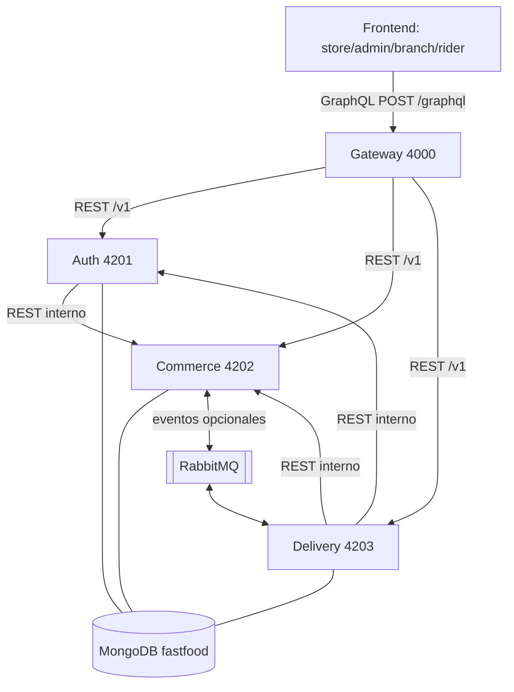

### (2) Ciclo de una request GraphQL

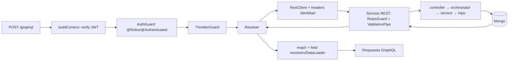

### (3) Login + refresh

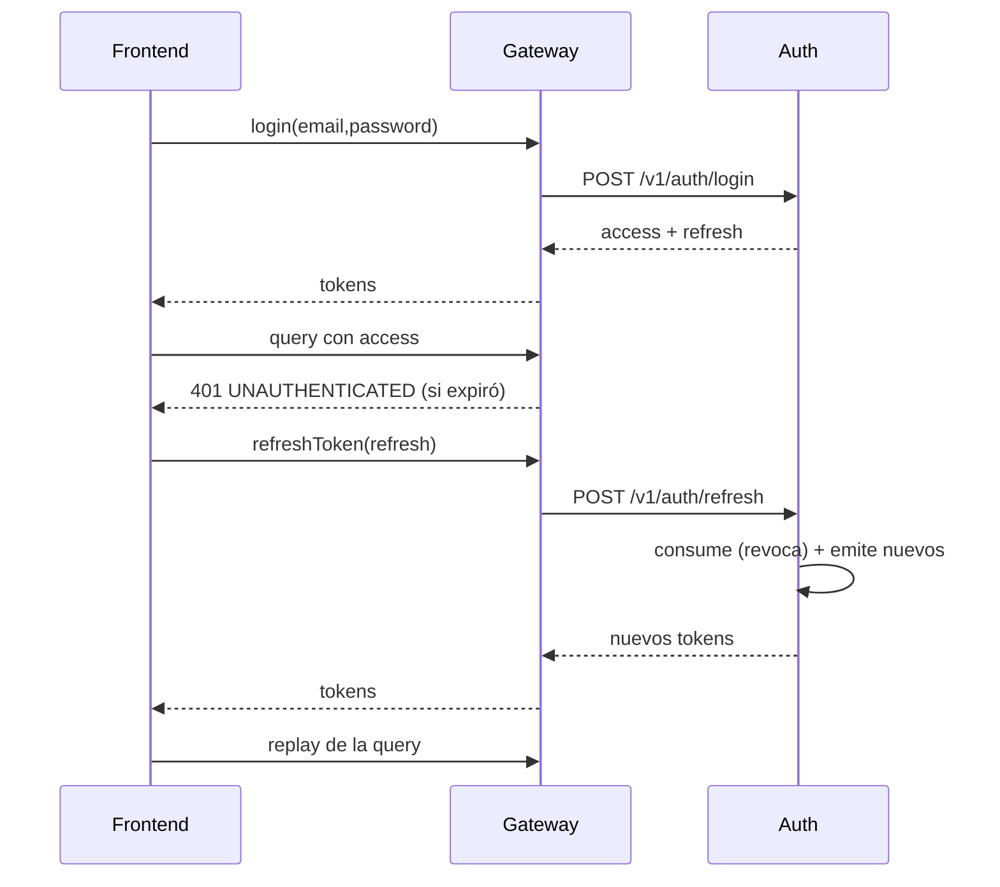

### (4) Creación de pedido

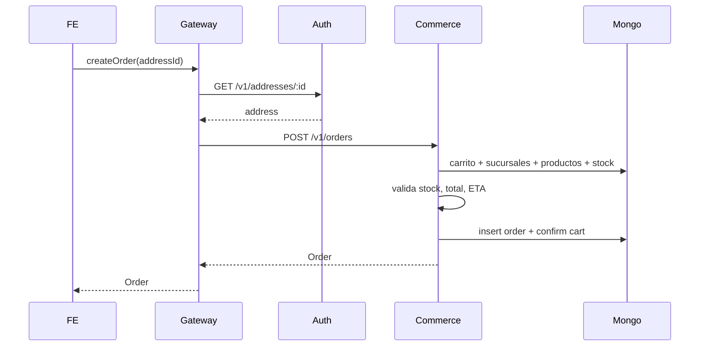

### (5) Estados del pedido

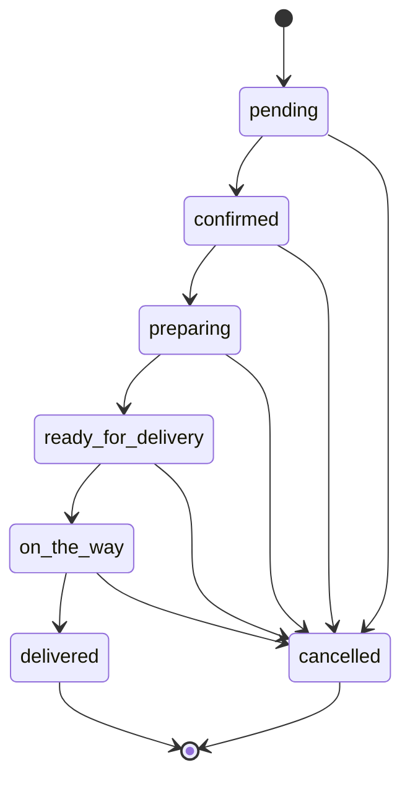

### (6) Oferta y viaje

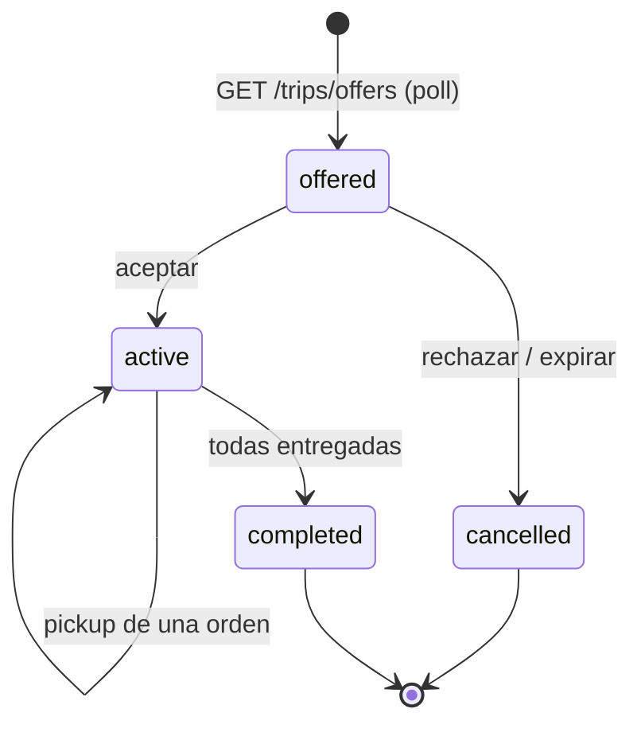

### (7) Eventos

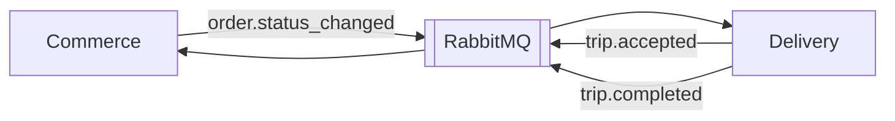

### (8) Rotación de ofertas

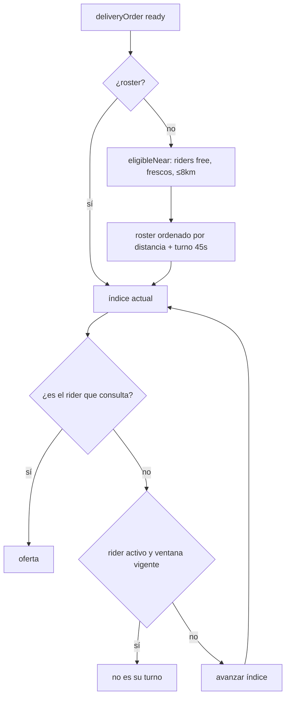

### (9) Modelo de datos

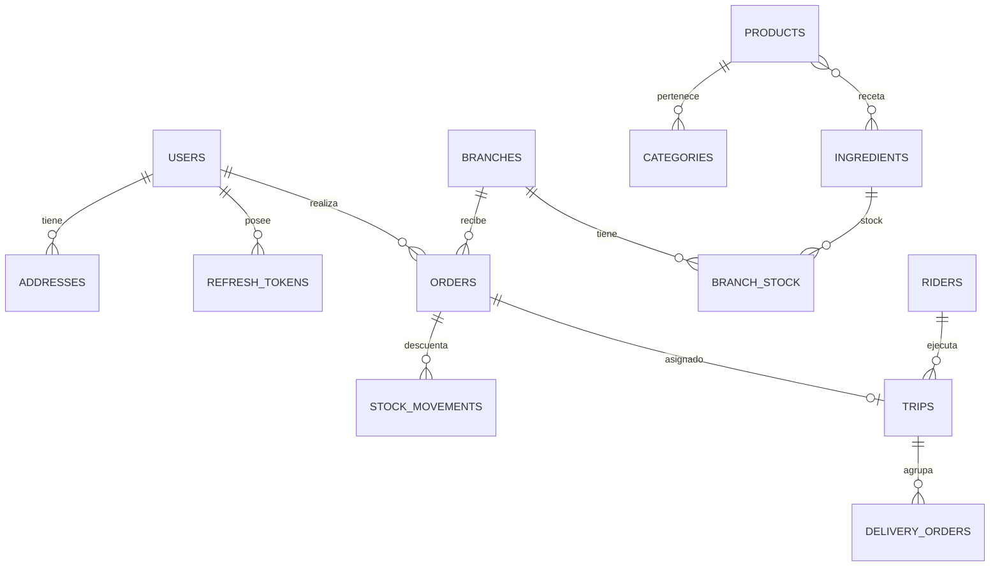

### (10) Deployment local

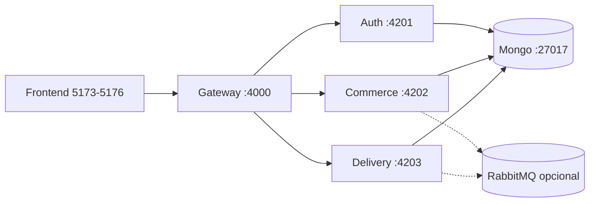

---

# 24. Glosario

- **Gateway**: app NestJS que expone GraphQL y traduce a REST; sin base de datos.
- **RestClient**: cliente HTTP interno del gateway con headers de identidad.
- **AuthContext**: `{ authenticated, userId, roles, branchId }` derivado del JWT.
- **RolesGuard**: guard global de los servicios REST (roles + token interno).
- **AuthGuard**: guard de GraphQL (metadata de roles/autenticación).
- **Internal token**: `x-internal-token` compartido para llamadas servicio-a-servicio.
- **Orchestrator**: capa que coordina varios dominios/servicios; único lugar donde se cruzan servicios primarios.
- **Servicio primario**: lógica de un dominio; sólo habla con su repositorio.
- **DTO**: clase con validaciones `class-validator` para entrada REST.
- **DomainException**: excepción con `code`, `message` y status HTTP.
- **Access token**: JWT de 15 min con `sub/userId/roles/branchId`.
- **Refresh token**: token opaco de 7 días, hasheado, de un solo uso.
- **`processedEvents`**: colección de dedupe de eventos en delivery (TTL 7 días).
- **`deliveryOrder`**: proyección local de un pedido listo para reparto (`ready/reserved/assigned`).
- **Trip / viaje**: agrupación de hasta 3 pedidos asignados a un rider (`offered/active/completed/cancelled`).
- **Oferta**: propuesta de viaje con distancia, minutos, ganancia y expiración (30 s).
- **Rotación**: mecanismo de fairness por pedido (roster + índice + ventana de 45 s).
- **Staleness**: rider sin ubicación por más de 5 min deja de ser elegible.
- **Haversine**: distancia geográfica en km.
- **ETA**: `estimatedDeliveryAt` calculado con preparación + viaje.
- **Snapshot de dirección**: copia de `text/lat/lng` guardada en el pedido.
- **`availableTransitions`**: transiciones válidas calculadas desde `ORDER_TRANSITIONS`.
- **`orderStates`**: catálogo configurable de estados para la UI; no gobierna transiciones.
- **Seed**: datos de desarrollo (usuarios, catálogo, stock, pedidos, rider).
- **Turborepo**: orquestador del monorepo.
- **Mongoose**: ODM de MongoDB.
- **Apollo Server**: servidor GraphQL del gateway.
- **Cloudinary**: storage de imágenes.
- **Resend**: proveedor de email opcional.
- **RabbitMQ / `BROKER_URL`**: broker opcional para eventos cross-service.
- **In-process transport**: bus local usado cuando no hay broker.
- **branchId**: sucursal del `branch_admin`; se usa para scoping.
- **`super_admin`**: rol global sin scoping.
- **`customer`**: cliente; carrito/pedidos/direcciones propias.
- **`rider`**: repartidor; ofertas/viajes propios.
- **`branch_admin`**: administrador de una sucursal.

---

# Si tuviera que explicar el backend en 5 minutos

“Food Bosco tiene un backend en **monorepo NestJS** con **cuatro aplicaciones**: un **GraphQL Gateway** y tres servicios de dominio —**auth**, **commerce** y **delivery**—, cada uno con su propia conexión a **MongoDB** y dueño de sus colecciones.

El **gateway** es la única puerta de entrada del frontend: expone `POST /graphql`, verifica el **JWT**, aplica **RBAC** y **rate limiting**, traduce cada operación a llamadas **REST** internas y compone las relaciones entre servicios con **DataLoaders**. No tiene lógica de negocio ni base de datos. Los servicios REST tienen **RolesGuard**, **ValidationPipe** y filtros de error comunes, y siguen la arquitectura por dominio: `controller → orchestrator → service → repository`. La regla de oro es que **un servicio primario nunca llama a otro**: la coordinación vive en los **orchestrators**.

La **autenticación** es JWT: access token de 15 minutos y refresh token opaco, guardado **hasheado**, de un solo uso, con rotación y TTL de 7 días. El logout y el reset de contraseña revocan todas las sesiones. Los roles son `customer`, `branch_admin`, `super_admin` y `rider`; el `branchId` del JWT se usa para **aislar** los datos de cada sucursal y el `clientId` para los pedidos del cliente.

El flujo de compra es: **carrito server-side** → checkout con `addressId` → commerce busca la **sucursal más cercana activa y abierta** dentro del radio → valida **disponibilidad producto-sucursal** y **stock por receta** → calcula **total y ETA** → crea el pedido en `pending` → confirma el carrito. El pedido avanza por una **máquina de estados hardcodeada**: `pending → confirmed → preparing → ready_for_delivery → on_the_way → delivered`, con `cancelled`. El stock se **descuenta al pasar a `preparing`**. La sucursal, el precio final, el stock y las transiciones los decide el **backend**.

Cuando un pedido pasa a `ready_for_delivery`, commerce publica **`order.status_changed`**. Delivery lo consume y lo agrega a su **pool de reparto**. El rider se pone **online**, manda su **ubicación** y consulta **ofertas** por polling: el backend le arma una oferta con los pedidos **más cercanos a su sucursal**, respetando una **rotación** de riders y un **TTL de 30 segundos**. La oferta se **reserva atómicamente** para que dos riders no tomen el mismo pedido. Al aceptar, el rider pasa a `on_trip`; al **retirar** y **entregar** cada pedido, delivery actualiza commerce por REST interno. Cuando todas las órdenes se entregan, el viaje se completa y el rider vuelve a `free`.

Los eventos usan **RabbitMQ opcional**. Si `BROKER_URL` no está configurado, cada servicio usa un bus **in-process**: los eventos no cruzan servicios. Por eso, para la demo, o se levanta RabbitMQ o se usa el **seed**, que inserta directamente un pedido listo para delivery.

En **reportes**, commerce usa agregaciones de MongoDB: revenue sin cancelados, ticket promedio, serie temporal por día/semana/mes en timezone de Buenos Aires, top productos y performance por sucursal, comparando contra el período anterior.

Para cerrar, lo que **no** hay que exagerar: no hay pagos, ni promociones aplicadas al precio, ni zonas/turnos en el matching, ni transacciones de stock, y la validación de proximidad de 50 metros está **sólo en el frontend**. Son las deudas técnicas que asumimos y que sé explicar.”

---

# Si sólo tuviera 1 minuto

“Backend NestJS en monorepo con **4 apps**: **gateway GraphQL** (4000, sin DB) + **auth** (4201) + **commerce** (4202) + **delivery** (4203), todas con MongoDB. El gateway autentica con **JWT**, aplica **roles** y **rate limit**, traduce a **REST** y compone con **DataLoaders**. Los servicios siguen `controller → orchestrator → service → repository`; **un servicio primario no llama a otro**. La autenticación usa access token de 15 min y **refresh opaco hasheado de un solo uso**. Los pedidos nacen desde un **carrito server-side**, con **sucursal asignada por cercanía**, **stock validado** y **ETA**; el estado avanza por una **máquina hardcodeada** y el stock se descuenta al pasar a `preparing`. Delivery asigna **ofertas por cercanía con rotación y reserva atómica**, TTL 30 s. Los eventos van por **RabbitMQ opcional** (sin broker, in-process). Lo que falta: pagos, promociones aplicadas, zonas/turnos en matching, transacciones de stock y validación de proximidad en el servidor.”

---

# 25. Checklist de estudio

```text
[ ] Sé explicar por qué hay un gateway GraphQL y por qué REST adentro
[ ] Sé dibujar las 4 apps, puertos y responsabilidades
[ ] Sé explicar la regla controller → orchestrator → service → repository
[ ] Sé explicar por qué un servicio primario no llama a otro
[ ] Sé explicar el ciclo de una request GraphQL (contexto, guards, REST, mappers/DataLoader)
[ ] Sé explicar login, JWT access, refresh opaco y rotación
[ ] Sé explicar logout y reset (revocación global)
[ ] Sé explicar recuperación de contraseña (neutral, TTL, ventana, link por rol)
[ ] Sé explicar RBAC en dos capas y scoping por branchId/clientId/riderId
[ ] Sé explicar el token interno y @Internal
[ ] Sé explicar la creación de pedido paso a paso
[ ] Sé explicar cómo se elige la sucursal y qué pasa si no hay
[ ] Sé explicar cómo se calcula el total y el ETA
[ ] Sé explicar la validación de stock y el descuento en preparing
[ ] Sé explicar la máquina de estados y availableTransitions
[ ] Sé explicar el flujo de ofertas (polling, rotación, TTL, reserva atómica)
[ ] Sé explicar pickup/deliver y la actualización de commerce
[ ] Sé explicar el modelo de datos y las colecciones
[ ] Sé explicar eventos, idempotencia y el caveat sin RabbitMQ
[ ] Sé explicar reportes y sus filtros
[ ] Sé explicar qué NO hace el backend (pagos, promociones aplicadas, zonas/turnos)
[ ] Sé explicar los riesgos (stock no atómico, count+1, servicios expuestos, secretos default)
[ ] Sé explicar qué cambiaría para producción
[ ] Sé listar las operaciones GraphQL principales
[ ] Sé listar los endpoints REST principales
[ ] Sé correr el seed y explicar las credenciales
[ ] Sé explicar las diferencias docs vs código (§21)
```

---

# 26. Evidencia del código

Mapa rápido archivo → responsabilidad:

## Gateway

- `apps/gateway/src/main.ts` → bootstrap, CORS, puerto.
- `apps/gateway/src/app.module.ts` → módulos + RequestIdMiddleware.
- `apps/gateway/src/gateway/gateway.module.ts` → Apollo (`autoSchemaFile`, context, formatError).
- `apps/gateway/src/gateway/gateway.context.ts` → `buildContext` (JWT → AuthContext).
- `apps/gateway/src/security/jwt.service.ts` → verificación HS256.
- `apps/gateway/src/security/auth.guard.ts` → RBAC GraphQL.
- `apps/gateway/src/security/roles.guard.ts` → RBAC del upload.
- `apps/gateway/src/rest/rest.client.ts` → fetch + headers + errores.
- `apps/gateway/src/rest/data-loader.ts` → DataLoader propio.
- `apps/gateway/src/graphql/commerce/commerce.resolver.ts` → queries/mutations de comercio.
- `apps/gateway/src/graphql/commerce/commerce.fields.resolver.ts` → field resolvers.
- `apps/gateway/src/graphql/commerce/commerce.dataloaders.ts` → loaders por request.
- `apps/gateway/src/graphql/auth/auth.resolver.ts` → auth/usuarios/direcciones.
- `apps/gateway/src/graphql/delivery/delivery.resolver.ts` → rider/ofertas/viajes.
- `apps/gateway/src/observability/graphql-error-formatter.ts` → contrato de errores.
- `apps/gateway/src/throttle/throttle.guard.ts` → rate limit GraphQL.
- `apps/gateway/src/upload/upload.controller.ts` → `POST /v1/uploads`.
- `apps/gateway/src/seed/seed.controller.ts` → `POST /seed`.

## Auth

- `apps/auth/src/main.ts` → ValidationPipe + filtro.
- `apps/auth/src/auth/auth.controller.ts` → endpoints de sesión.
- `apps/auth/src/auth/auth.orchestrator.ts` → login/register/refresh/recovery/reset.
- `apps/auth/src/user/user.service.ts` → bcrypt, credenciales, usuarios.
- `apps/auth/src/config/security/jwt.service.ts` → firma/verificación.
- `apps/auth/src/refresh-token/*` → tokens opacos, TTL, revocación.
- `apps/auth/src/password-recovery/*` → tokens de reset.
- `apps/auth/src/email/*` → log/Resend + template + link por rol.
- `apps/auth/src/user/staff.orchestrator.ts` → valida sucursal contra commerce.
- `apps/auth/src/address/*` → CRUD scoped y soft delete.
- `apps/auth/src/seed/*` → usuarios/direcciones.

## Commerce

- `apps/commerce/src/order/order.orchestrator.ts` → creación, transición, repeat.
- `apps/commerce/src/order/order.service.ts` → máquina de estados + historial.
- `apps/commerce/src/order/order.model.ts` → colección `orders` + `availableTransitions`.
- `apps/commerce/src/cart/cart.orchestrator.ts` → carrito + total server-side.
- `apps/commerce/src/branch/branch.service.ts` → cobertura + horarios.
- `apps/commerce/src/branch/branch.model.ts` → `isBranchOpenNow` (TZ Buenos Aires).
- `apps/commerce/src/product/product.service.ts` → configuración/receta/reglas.
- `apps/commerce/src/stock/stock.service.ts` → validar/descontar/ajustar.
- `apps/commerce/src/reporting/*` → agregaciones y KPIs.
- `apps/commerce/src/parameter/parameter.service.ts` → parámetros de negocio.
- `apps/commerce/src/order-state/*` → catálogo de estados.
- `apps/commerce/src/promotion/*` → CRUD sin aplicación al precio.
- `apps/commerce/src/upload/*` → Cloudinary.
- `apps/commerce/src/config/messaging/*` → EventBus + Rabbit/in-process.
- `apps/commerce/src/seed/*` → catálogo/stock/pedidos.

## Delivery

- `apps/delivery/src/offer/offer.orchestrator.ts` → ofertas, matching, ruta, ganancia, accept/reject/pickup/deliver.
- `apps/delivery/src/delivery-order/delivery-order.service.ts` → pool, rotación, reservas, idempotencia.
- `apps/delivery/src/delivery-order/delivery-order.repository.ts` → `updateMany` atómico, `processedEvents`.
- `apps/delivery/src/trip/trip.service.ts` → estados del viaje, pickup/deliver.
- `apps/delivery/src/rider/rider.service.ts` → disponibilidad/ubicación/status.
- `apps/delivery/src/rider/rider.orchestrator.ts` → perfil on-demand desde auth.
- `apps/delivery/src/rider/rider.model.ts` → `isRiderStale`, normalización de vehículo.
- `apps/delivery/src/config/http/commerce.client.ts` → PATCH de estado con token interno.
- `apps/delivery/src/config/messaging/*` → eventos y reintentos.
- `apps/delivery/src/zone/*`, `shift/*` → CRUD sin matching.
- `apps/delivery/src/seed/*` → rider/zonas/turnos/pedido listo.

## Tests y docs

- `apps/gateway/test/*` → matriz de autorización, seguridad, errores, DataLoader, upload, throttle.
- `apps/commerce/test/*`, `apps/auth/test/*`, `apps/delivery/test/*` → e2e por dominio.
- `docs/especificaciones/fundamentacion-gateway-graphql-rest.md` → decisión arquitectónica.
- `docs/especificaciones/requerimientos-backend-rest.md` → requerimientos funcionales.
- `docs/testing/matriz-cobertura.md`, `docs/testing/bug-report.md` → cobertura/hallazgos.
- `docs/credenciales-seed.md` → usuarios de demo.
- `CLAUDE.md` → regla de arquitectura y skills.
- `turbo.json` → variables de entorno y tasks.
