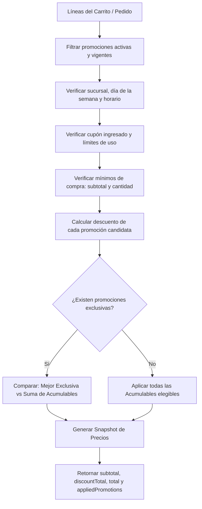

# Sistema de Promociones y Descuentos — Documento de Implementación

> **Estado:** OFICIAL / IMPLEMENTADO (Alcance C — Completo)  
> **Servicio principal:** `apps/commerce` (`Commerce Service`)  
> **Capa de exposición:** `apps/gateway` (`GraphQL Gateway`)  
> **Frontends integrados:** `apps/admin`, `apps/store`, `@repo/domain`, `@repo/api`, `@repo/components`

---

## 1. Resumen Ejecutivo y Objetivos

El sistema de promociones implementa el **Alcance C (Completo)** planificado en `Plan-sistema-promociones.md`. Su objetivo es otorgar una capacidad comercial completa y flexible a la plataforma Food Bosco, permitiendo definir descuentos porcentuales, montos fijos en pesos y promociones por volumen ($N \times M$), con alcance configurable a nivel de pedido, categoría o producto individual, con control de horarios, días, sucursales y topes de uso globales o por cliente.

El cálculo del precio es **autoritativo y exclusivo del servidor**. El cliente (frontends) no calcula ni puede manipular importes; simplemente visualiza y refleja el estado y el desglose proveído por la API.

---

## 2. Alcance C (Completo)

### 2.1 Tipos de Beneficios (`PromotionType`)

1. **`PERCENTAGE` (Porcentaje):**
   - Aplica un porcentaje de descuento sobre los ítems que caen dentro del alcance (o subtotal del pedido).
   - Soporta un tope opcional (`maxDiscount`) en pesos. Si el descuento calculado excede el tope, se trunca al valor de `maxDiscount`.
2. **`FIXED_AMOUNT` (Monto fijo):**
   - Descuenta un importe monetario plano en pesos sobre los productos del alcance.
   - Si el valor de los productos alcanzados es inferior al monto fijo, el descuento se acota al valor de dichos productos (el subtotal con descuento nunca es negativo).
3. **`BUY_X_GET_Y` ($N \times M$):**
   - Regla de volumen ("Lleva $X$, Paga $Y$"), por ejemplo $2 \times 1$ ($X=2, Y=1$) o $3 \times 2$ ($X=3, Y=2$).
   - Descuenta los ítems **más económicos** de los grupos completos de $X$ unidades para beneficiar al cliente de forma predecible y consistente.

### 2.2 Alcances (`PromotionScope`)

- **`ORDER`:** Aplica sobre la totalidad de los ítems del pedido.
- **`CATEGORY`:** Aplica únicamente sobre las líneas cuyos productos pertenezcan a las categorías especificadas en `categoryIds`.
- **`PRODUCT`:** Aplica únicamente sobre las líneas de los productos individuales indicados en `productIds`.

### 2.3 Restricciones y Condiciones

- **Vigencia temporal:** Rango de fechas ISO (`startDate`, `endDate`).
- **Estado activo:** Flag booleano `active` editable de inmediato.
- **Días de la semana:** Array `daysOfWeek` ($0=$ Domingo, $1=$ Lunes ... $6=$ Sábado). Si está vacío, aplica todos los días.
- **Ventana horaria:** `startTime` y `endTime` en formato `HH:mm`. Soporta intervalos diurnos y **ventanas que cruzan la medianoche** (por ejemplo, turnos nocturnos de 20:00 a 02:00).
- **Sucursales:** Array `branchIds`. Si está vacío, aplica en todas las sucursales. Si se especifica, solo aplica cuando el pedido o carrito se asigna a dicha sucursal.
- **Monto mínimo:** `minSubtotal` en pesos.
- **Cantidad mínima:** `minQuantity` de unidades en el alcance.

### 2.4 Cupones y Límites

- **Cupones de descuento:** Código en mayúsculas (`code`), con índice único `sparse` en MongoDB.
- **Límites de uso:**
  - `maxUsesTotal`: Tope global acumulado de redenciones.
  - `maxUsesPerCustomer`: Tope de redenciones por cliente.
- **Ledger de redenciones:** Colección `promotionRedemptions` que registra cada redención (`APPLIED`) y permite auditoría y liberación (`RELEASED`) ante cancelaciones.
- **Acumulabilidad:** Flag `stackable` y `priority` (0 a 100). El motor evalúa la mejor opción entre la mejor promoción exclusiva y la suma de promociones acumulables.

---

## 3. Arquitectura del Motor de Precios (`PromotionEngine`)

El motor de cálculo (`apps/commerce/src/promotions/promotion-engine.ts`) es un módulo **puro y determinístico**, libre de llamadas de base de datos o efectos secundarios durante la evaluación.

### 3.1 Algoritmo de Evaluación

### 3.2 Lógica $N \times M$ (`BUY_X_GET_Y`)

Para cada promoción $N \times M$:

1. Se desagregan todas las unidades elegibles de los ítems en una lista plana de precios unitarios.
2. Se ordenan ascendentemente por precio unitario.
3. Se calcula cuántos grupos completos de $X$ unidades (`buyQuantity`) existen:  
   $$\text{grupos} = \lfloor \text{total\_unidades} / X \rfloor$$
4. Por cada grupo completo, se descuentan las $X - Y$ unidades más baratas:  
   $$\text{unidades\_a\_descontar} = \text{grupos} \times (X - Y)$$
5. El descuento acumulado es la suma de los precios de las primeras $\text{unidades\_a\_descontar}$ unidades más baratas.

---

## 4. Ledger de Redenciones y Concurrencia

Para garantizar que los límites de uso por cliente (`maxUsesPerCustomer`) y totales (`maxUsesTotal`) no sufran condiciones de carrera ni inconsistencias ante cancelaciones:

1. **Colección `promotionRedemptions`:**
   - `promotionId`: ObjectId
   - `customerId`: string
   - `orderId`: ObjectId
   - `status`: `'APPLIED' | 'RELEASED'`
   - `createdAt`: fecha
   - `releasedAt`: fecha opcional
2. **Índices de MongoDB:**
   - `{ promotionId: 1, customerId: 1, status: 1 }`
   - `{ orderId: 1 }`
3. **Flujo de confirmación de pedido (`OrderOrchestrator.createOrder`):**
   - Se valida el límite contra el ledger activo (`status: 'APPLIED'`).
   - Se inserta el registro de redención en la base.
   - Se incrementa atómicamente `usedCount` en la promoción.
4. **Flujo de cancelación de pedido (`OrderOrchestrator.updateStatus` a `cancelled`):**
   - Se buscan las redenciones asociadas a la orden.
   - Se marcan como `RELEASED` con `releasedAt: new Date()`.
   - Se decrementa `usedCount` en la promoción con `$inc: { usedCount: -1 }` (sin bajar de 0).

---

## 5. Snapshot de Precios Autoritativo

Tanto en la entidad `Cart` como en `Order`, el cálculo de precios queda congelado en un snapshot inmutable:

| Campo               | Tipo           | Significado                                                                |
| ------------------- | -------------- | -------------------------------------------------------------------------- |
| `subtotal`          | Number         | Monto bruto de los productos sin descuentos.                               |
| `discountTotal`     | Number         | Monto total deducido por promociones y cupones.                            |
| `total`             | Number         | **Importe neto final a cobrar al cliente** (`subtotal - discountTotal`).   |
| `promotionCode`     | String \| null | Código de cupón ingresado.                                                 |
| `appliedPromotions` | Array          | Lista de promociones aplicadas con `id`, `name`, `type`, `discountAmount`. |

En reportes y métricas de ventas (`reporting.repository.ts`):

- Los ingresos (`totalRevenue`, `sales`) toman `order.total` como el ingreso neto real facturado.
- Se agregó el KPI `totalDiscounts` (`$sum: '$discountTotal'`) para visualizar el total de beneficios otorgados sin alterar la semántica de caja.

---

## 6. Endpoints y Esquema GraphQL

### 6.1 Endpoints REST (`Commerce Service`)

- `GET /v1/promotions`: Listado administrativo completo de promociones.
- `GET /v1/promotions/:id`: Detalle administrativo de una promoción.
- `POST /v1/promotions`: Creación de promoción (Admin).
- `PATCH /v1/promotions/:id`: Actualización de promoción (Admin).
- `PATCH /v1/promotions/:id/status`: Toggle de estado activo/inactivo.
- `GET /v1/catalog/promotions/public`: Promociones públicas activas para banners en tienda (sin campos sensibles de control interno).
- `PUT /v1/cart/promotion-code`: Aplicación o remoción de código de cupón en el carrito del cliente.

### 6.2 Esquema GraphQL (`Gateway`)

- Query `publicPromotions: [Promotion!]!`
- Query `myCart(addressId: ID): Cart!`
- Mutation `setCartPromotionCode(code: String): Cart!`
- Mutations administrativas: `createPromotion`, `updatePromotion`, `setPromotionActive`.

---

## 7. Experiencia de Usuario en Frontends

### 7.1 Admin (`apps/admin`)

- **Ruta `/promotions`:** Tabla de promociones con búsqueda, filtro por tipo y estado, switch rápido de activación y visualización de cupón y ratio de usos.
- **Ruta `/promotions/new` y `/promotions/:id/edit`:** Editor completo organizado en 5 pestañas:
  1. _General:_ Nombre, descripción, estado activo, vigencia (fechas).
  2. _Beneficio:_ Tipo (`PERCENTAGE`, `FIXED_AMOUNT`, `BUY_X_GET_Y`), valor de descuento, tope y cantidades $X/Y$.
  3. _Alcance:_ Ámbito (`ORDER`, `CATEGORY`, `PRODUCT`), selección múltiple con chips y selección opcional de sucursales.
  4. _Condiciones:_ Días de la semana interactivos, franja horaria `HH:mm`, compra mínima en pesos y mínimo de unidades.
  5. _Cupón y Límites:_ Código de cupón con mayúsculas automáticas, acumulabilidad, prioridad y límites de uso totales y por cliente.

### 7.2 Tienda (`apps/store`)

- **Home:** Sección "Promociones destacadas" conectada a `publicPromotions`.
- **Carrito (`/cart`):** Tarjeta de cupón de descuento para ingresar o quitar códigos con feedback visual inmediato, y `OrderTotalCard` con desglose de subtotal bruto, descuentos y total a pagar.
- **Checkout (`/checkout`):** Desglose transparente de promociones aplicadas.
- **Seguimiento (`/orders/:id`):** Resumen fiel del snapshot con subtotal, descuentos y total definitivo.
